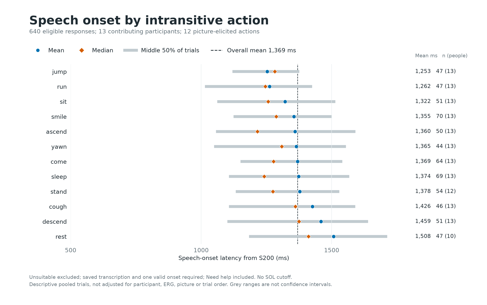
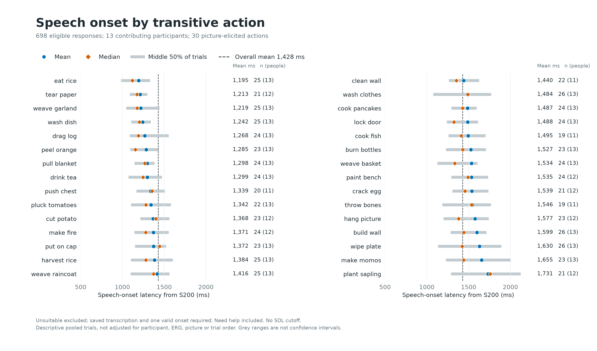

# Speech Onset by Picture-Elicited Action

Frozen cohort: 2026-10-15T20:21:07.023952+00:00.

SOL = saved acoustic speech onset minus S200. Eligible main trials only; Unsuitable excluded; transcription and one valid onset required; Need help included. All contributing participants included; no timing exclusions.

Actions describe the pictures, not a guaranteed spoken verb. Pooled means/medians are descriptive. Picture, participant, ERG marking, noun choice and trial order can differ across actions. Only one or two eligible examples of an action usually remain per person. No causal claim, significance test or normality assumption is made.

Participant-centering subtracts each participant's mean within transitivity, averages these residuals per action, then adds the pooled transitivity mean. This is a descriptive check, not a fully adjusted model or independent effect estimate. Extreme-action contrasts below were selected after inspecting the means and are not confirmatory comparisons.

## Intransitive

| Action | n | People | Mean ms | Median ms | Q1 ms | Q3 ms | Participant-centered mean ms |
|---|---:|---:|---:|---:|---:|---:|---:|
| jump | 47 | 13 | 1253.0 | 1282.0 | 1119.7 | 1376.2 | 1260.8 |
| run | 47 | 13 | 1262.2 | 1246.2 | 1014.6 | 1425.1 | 1261.9 |
| sit | 51 | 13 | 1321.9 | 1256.7 | 1061.7 | 1514.1 | 1330.4 |
| smile | 70 | 13 | 1355.2 | 1287.9 | 1124.3 | 1501.1 | 1354.8 |
| ascend | 50 | 13 | 1359.9 | 1215.4 | 1056.8 | 1591.0 | 1365.3 |
| yawn | 44 | 13 | 1364.7 | 1309.1 | 1049.6 | 1554.5 | 1378.8 |
| come | 64 | 13 | 1369.5 | 1277.5 | 1150.6 | 1541.2 | 1372.7 |
| sleep | 69 | 13 | 1374.0 | 1241.5 | 1106.5 | 1567.5 | 1376.4 |
| stand | 54 | 12 | 1377.8 | 1274.8 | 1132.6 | 1529.4 | 1337.9 |
| cough | 46 | 13 | 1426.1 | 1360.8 | 1106.8 | 1590.6 | 1429.3 |
| descend | 51 | 13 | 1459.1 | 1375.1 | 1100.6 | 1639.7 | 1466.2 |
| rest | 47 | 10 | 1507.9 | 1411.2 | 1183.6 | 1712.7 | 1499.9 |

In 9/10 participants with usable responses for both jump and rest, the participant's mean was longer for rest.

## Transitive

| Action | n | People | Mean ms | Median ms | Q1 ms | Q3 ms | Participant-centered mean ms |
|---|---:|---:|---:|---:|---:|---:|---:|
| eat rice | 25 | 13 | 1194.6 | 1118.4 | 983.3 | 1330.6 | 1182.1 |
| tear paper | 21 | 12 | 1212.8 | 1175.0 | 1087.7 | 1297.8 | 1252.4 |
| weave garland | 25 | 13 | 1219.4 | 1176.7 | 1046.4 | 1442.8 | 1220.9 |
| wash dish | 25 | 13 | 1242.2 | 1202.4 | 1106.3 | 1339.9 | 1242.3 |
| drag log | 24 | 13 | 1268.2 | 1192.1 | 1088.9 | 1553.7 | 1257.4 |
| peel orange | 23 | 13 | 1284.5 | 1155.0 | 1094.1 | 1426.4 | 1289.9 |
| pull blanket | 24 | 13 | 1298.5 | 1267.8 | 1145.6 | 1383.9 | 1306.2 |
| drink tea | 24 | 13 | 1299.0 | 1246.5 | 1073.4 | 1473.7 | 1296.5 |
| push chest | 20 | 11 | 1338.8 | 1356.6 | 1168.5 | 1509.7 | 1375.1 |
| pluck tomatoes | 22 | 13 | 1342.4 | 1281.7 | 1103.8 | 1580.6 | 1341.6 |
| cut potato | 23 | 12 | 1368.2 | 1402.4 | 1214.6 | 1561.8 | 1359.7 |
| make fire | 24 | 12 | 1370.7 | 1278.5 | 1143.3 | 1554.2 | 1379.9 |
| put on cap | 23 | 13 | 1372.2 | 1445.4 | 1150.8 | 1523.2 | 1389.3 |
| harvest rice | 25 | 13 | 1384.4 | 1282.2 | 1101.7 | 1604.6 | 1373.1 |
| weave raincoat | 25 | 13 | 1415.9 | 1373.9 | 1099.6 | 1564.6 | 1403.4 |
| clean wall | 22 | 11 | 1440.3 | 1354.0 | 1262.4 | 1625.9 | 1433.9 |
| wash clothes | 26 | 13 | 1484.3 | 1491.0 | 1075.3 | 1769.7 | 1476.1 |
| cook pancakes | 24 | 13 | 1486.7 | 1427.2 | 1294.2 | 1596.2 | 1456.5 |
| lock door | 24 | 13 | 1488.2 | 1323.9 | 1237.8 | 1613.2 | 1498.9 |
| cook fish | 19 | 11 | 1495.0 | 1410.8 | 1260.0 | 1701.7 | 1510.8 |
| burn bottles | 23 | 13 | 1526.9 | 1429.3 | 1228.3 | 1705.9 | 1491.2 |
| weave basket | 24 | 13 | 1533.7 | 1334.2 | 1126.4 | 1604.3 | 1529.7 |
| paint bench | 24 | 12 | 1535.2 | 1493.4 | 1292.1 | 1733.3 | 1537.7 |
| crack egg | 21 | 12 | 1539.2 | 1455.5 | 1305.3 | 1736.4 | 1542.9 |
| throw bones | 19 | 11 | 1545.5 | 1534.2 | 1184.7 | 1768.4 | 1553.1 |
| hang picture | 23 | 12 | 1576.9 | 1379.2 | 1200.2 | 1740.4 | 1580.5 |
| build wall | 26 | 13 | 1599.5 | 1442.6 | 1283.5 | 1713.8 | 1591.2 |
| wipe plate | 26 | 13 | 1629.6 | 1422.4 | 1132.9 | 1891.1 | 1621.3 |
| make momos | 23 | 13 | 1654.8 | 1440.4 | 1228.3 | 2004.9 | 1671.9 |
| plant sapling | 21 | 12 | 1731.5 | 1758.7 | 1290.5 | 2123.0 | 1732.9 |

In 11/12 participants with usable responses for both eat rice and plant sapling, the participant's mean was longer for plant sapling.

## Figures

