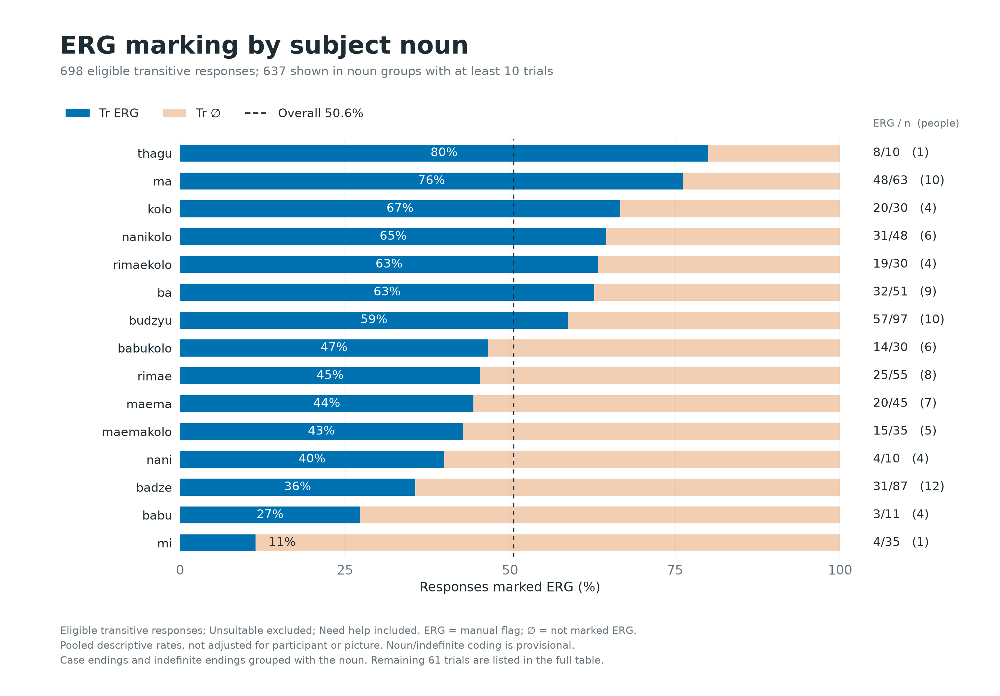
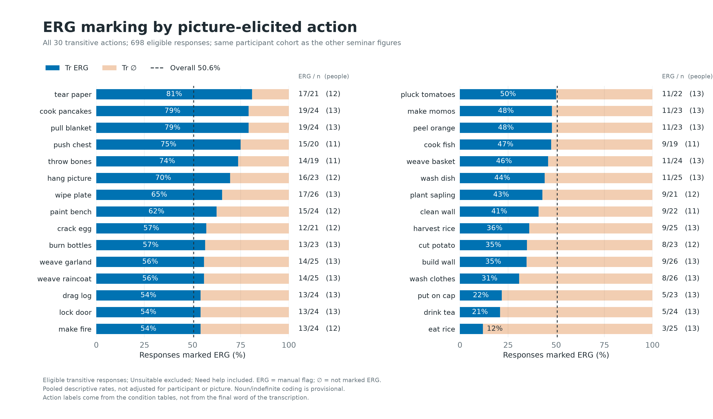
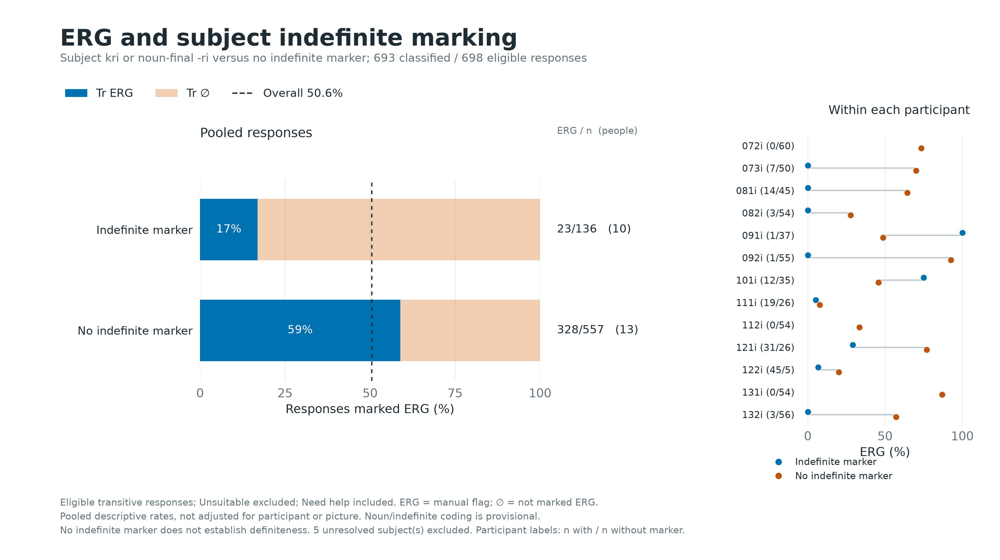

# ERG Associations: Descriptive Seminar Figures

Frozen snapshot: 2026-10-15T20:21:07.023952+00:00. 698 eligible transitive trials (353 marked ERG, 345 not marked ERG), 13 participants.

## Interpretation

Percentages are observed, pooled ERG-flag rates, not adjusted probabilities or causal effects. Participant, picture/action, noun and indefinite marking are not balanced. No significance test is applied. The within-participant panel makes some of this imbalance visible; it is not a fitted model.

Main trials only. Saved nonblank transcription and one valid onset required; Unsuitable excluded; Need help included. No SOL cutoff or participant exclusion. ERG is the manual viewer flag. Unmarked includes missing saved ERG decisions; spelling is never used to override the outcome.

## Coding

The initial nominal following an optional initial demonstrative sequence and/or kri is the candidate subject head. This positional rule has been checked against the token inventory, but is not a validated Gurung grammatical parser. Interpret noun and indefinite comparisons as provisional until the per-trial coding is checked.

Indefinite evidence is kri immediately before/after that head, or a noun ending in ri, following the user's rule. Later kri in an object phrase is ignored. A question mark after kri marks uncertain case, not uncertain recognition of kri. Absence of either marker is called **no indefinite marker**, never definite.

Visible hyphenated -i, -yi, -ye, or -? are removed for noun grouping only. Indefinite -ri is removed before matching aliases. Confirmed indefinite variants are grouped with the noun. Unconfirmed diacritic/compound differences remain separate. Full mapping is in the codebook.

The literal ri rule also catches **misteri** (081i main-028); its lexical interpretation needs checking. It is provisionally included in the indefinite category but its noun group is unresolved. 091i main-075 (`tsu mla...`) lacks a recognized initial subject noun and is unresolved in both analyses.

Picture action is the transitive part of dataset_label, matched by list/item code and checked against condition, image set, stimulus set, target filename and scene. Both original condition-table hashes match the frozen snapshot.

## Noun Mapping

| Input form after ending removal | Group |
|---|---|
| maemae | maema |
| nanikola | nanikolo |
| rima | rimae |
| maemakola | maemakolo |
| babukola | babukolo |
| kola | kolo |
| rimaekola | rimaekolo |
| tshamiu | tshami |
| rimau | rimae |
| phrẽsiu | phrẽsi |
| rimaetshamiu | rimaetshami |
| kolotshamiu | kolotshami |
| maemaphresiu | maemaphresi |
| maemaephresiu | maemaphresi |
| maemaphrẽsiu | maemaphrẽsi |

## Subject Nouns

| Group | Tr ERG | Tr ∅ | Total n | ERG (%) | Participants | Need help |
|---|---:|---:|---:|---:|---:|---:|
| kolophrẽsi | 3 | 0 | 3 | 100.0 | 1 | 0 |
| tshamikolo | 3 | 0 | 3 | 100.0 | 1 | 0 |
| kolotshamiu-dzi | 1 | 0 | 1 | 100.0 | 1 | 0 |
| tshamikolo-dzi | 1 | 0 | 1 | 100.0 | 1 | 1 |
| thagu | 8 | 2 | 10 | 80.0 | 1 | 0 |
| ma | 48 | 15 | 63 | 76.2 | 10 | 6 |
| dada | 3 | 1 | 4 | 75.0 | 2 | 2 |
| kolo | 20 | 10 | 30 | 66.7 | 4 | 1 |
| thagukolo | 2 | 1 | 3 | 66.7 | 1 | 1 |
| nanikolo | 31 | 17 | 48 | 64.6 | 6 | 2 |
| rimaekolo | 19 | 11 | 30 | 63.3 | 4 | 5 |
| ba | 32 | 19 | 51 | 62.7 | 9 | 6 |
| budzyu | 57 | 40 | 97 | 58.8 | 10 | 9 |
| phrẽsikolo | 2 | 2 | 4 | 50.0 | 1 | 0 |
| babukolo | 14 | 16 | 30 | 46.7 | 6 | 2 |
| rimae | 25 | 30 | 55 | 45.5 | 8 | 6 |
| maema | 20 | 25 | 45 | 44.4 | 7 | 4 |
| maemakolo | 15 | 20 | 35 | 42.9 | 5 | 6 |
| naniphasĩ | 3 | 4 | 7 | 42.9 | 1 | 2 |
| nani | 4 | 6 | 10 | 40.0 | 4 | 3 |
| badze | 31 | 56 | 87 | 35.6 | 12 | 10 |
| Unresolved noun | 2 | 4 | 6 | 33.3 | 3 | 1 |
| phrẽsi | 2 | 4 | 6 | 33.3 | 2 | 0 |
| babu | 3 | 8 | 11 | 27.3 | 4 | 0 |
| mi | 4 | 31 | 35 | 11.4 | 1 | 0 |
| tshami | 0 | 6 | 6 | 0.0 | 1 | 0 |
| babuphasĩ | 0 | 4 | 4 | 0.0 | 1 | 2 |
| maemaphresi | 0 | 3 | 3 | 0.0 | 1 | 0 |
| budzyukuyu | 0 | 2 | 2 | 0.0 | 1 | 0 |
| rimaetshami | 0 | 2 | 2 | 0.0 | 1 | 0 |
| badzebuda | 0 | 1 | 1 | 0.0 | 1 | 0 |
| kolotshami | 0 | 1 | 1 | 0.0 | 1 | 0 |
| maemaphrẽsi | 0 | 1 | 1 | 0.0 | 1 | 0 |
| phresĩ | 0 | 1 | 1 | 0.0 | 1 | 1 |
| phresĩkolo | 0 | 1 | 1 | 0.0 | 1 | 0 |
| phrẽsĩ | 0 | 1 | 1 | 0.0 | 1 | 0 |

## Picture Actions

| Group | Tr ERG | Tr ∅ | Total n | ERG (%) | Participants | Need help |
|---|---:|---:|---:|---:|---:|---:|
| tear paper | 17 | 4 | 21 | 81.0 | 12 | 4 |
| cook pancakes | 19 | 5 | 24 | 79.2 | 13 | 1 |
| pull blanket | 19 | 5 | 24 | 79.2 | 13 | 5 |
| push chest | 15 | 5 | 20 | 75.0 | 11 | 1 |
| throw bones | 14 | 5 | 19 | 73.7 | 11 | 3 |
| hang picture | 16 | 7 | 23 | 69.6 | 12 | 3 |
| wipe plate | 17 | 9 | 26 | 65.4 | 13 | 3 |
| paint bench | 15 | 9 | 24 | 62.5 | 12 | 4 |
| crack egg | 12 | 9 | 21 | 57.1 | 12 | 2 |
| burn bottles | 13 | 10 | 23 | 56.5 | 13 | 4 |
| weave garland | 14 | 11 | 25 | 56.0 | 13 | 2 |
| weave raincoat | 14 | 11 | 25 | 56.0 | 13 | 0 |
| drag log | 13 | 11 | 24 | 54.2 | 13 | 3 |
| lock door | 13 | 11 | 24 | 54.2 | 13 | 4 |
| make fire | 13 | 11 | 24 | 54.2 | 12 | 1 |
| pluck tomatoes | 11 | 11 | 22 | 50.0 | 13 | 2 |
| make momos | 11 | 12 | 23 | 47.8 | 13 | 3 |
| peel orange | 11 | 12 | 23 | 47.8 | 13 | 2 |
| cook fish | 9 | 10 | 19 | 47.4 | 11 | 2 |
| weave basket | 11 | 13 | 24 | 45.8 | 13 | 3 |
| wash dish | 11 | 14 | 25 | 44.0 | 13 | 3 |
| plant sapling | 9 | 12 | 21 | 42.9 | 12 | 3 |
| clean wall | 9 | 13 | 22 | 40.9 | 11 | 2 |
| harvest rice | 9 | 16 | 25 | 36.0 | 13 | 2 |
| cut potato | 8 | 15 | 23 | 34.8 | 12 | 2 |
| build wall | 9 | 17 | 26 | 34.6 | 13 | 2 |
| wash clothes | 8 | 18 | 26 | 30.8 | 13 | 2 |
| put on cap | 5 | 18 | 23 | 21.7 | 13 | 2 |
| drink tea | 5 | 19 | 24 | 20.8 | 13 | 0 |
| eat rice | 3 | 22 | 25 | 12.0 | 13 | 0 |

## Subject Indefinite Marking

| Group | Tr ERG | Tr ∅ | Total n | ERG (%) | Participants | Need help |
|---|---:|---:|---:|---:|---:|---:|
| No indefinite marker | 328 | 229 | 557 | 58.9 | 13 | 43 |
| Unresolved subject | 2 | 3 | 5 | 40.0 | 2 | 1 |
| Indefinite marker | 23 | 113 | 136 | 16.9 | 10 | 26 |

## Indefinite Marking Within Participants

| Participant | ERG / n, indefinite | ERG (%) | ERG / n, no marker | ERG (%) |
|---|---:|---:|---:|---:|
| 072i | 0/0 | n.a. | 44/60 | 73.3 |
| 073i | 0/7 | 0.0 | 35/50 | 70.0 |
| 081i | 0/14 | 0.0 | 29/45 | 64.4 |
| 082i | 0/3 | 0.0 | 15/54 | 27.8 |
| 091i | 1/1 | 100.0 | 18/37 | 48.6 |
| 092i | 0/1 | 0.0 | 51/55 | 92.7 |
| 101i | 9/12 | 75.0 | 16/35 | 45.7 |
| 111i | 1/19 | 5.3 | 2/26 | 7.7 |
| 112i | 0/0 | n.a. | 18/54 | 33.3 |
| 121i | 9/31 | 29.0 | 20/26 | 76.9 |
| 122i | 3/45 | 6.7 | 1/5 | 20.0 |
| 131i | 0/0 | n.a. | 47/54 | 87.0 |
| 132i | 0/3 | 0.0 | 32/56 | 57.1 |

## Coding Checks

| Note | Trials |
|---|---:|
| need_help_flag_kept_in_analysis | 70 |
| unrecognized_noun_after_ri_removal | 1 |
| visible_case_ending_but_not_flagged_erg | 10 |
| uncertain_case_on_head | 11 |
| unrecognized_initial_head | 5 |
| uncertain_case_on_kri | 18 |

Case-ending/flag discrepancies are retained, not silently corrected. Need help does not exclude a trial. Trial-level notes and original transcription are in trial_linguistic_coding.csv.

## Reproduction

Run ergative_associations.py with --snapshot, --codebook and --output-dir. On another device, pass --condition-table-dir containing the same condition CSVs. The script verifies their hashes and rejects mismatches, duplicate keys and unmatched trials. Condition-table contents are also saved in condition_sources.json. Original annotations/decisions are not edited.

## Figures

