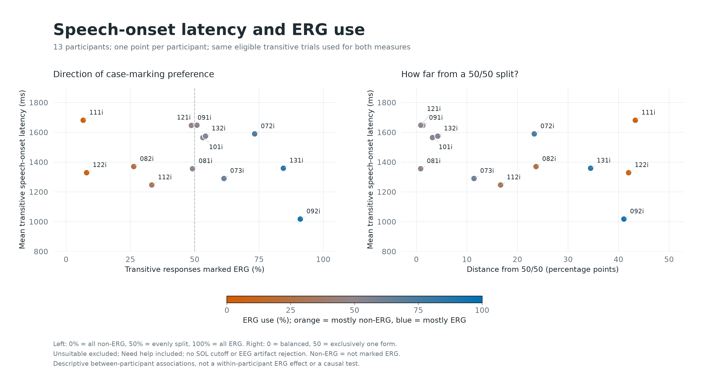

# Lab Seminar: Descriptive Statistics

Snapshot: 15 October 2026.

## Counting Rules

All 13 loaded recordings are included. Main trials only; practice and session events are excluded. SOL = annotated acoustic speech onset minus S200, in milliseconds. Eligible trials have nonblank saved transcription, exactly one valid speech onset, and are not marked Unsuitable. Need help remains included. No SOL cutoff, outlier trimming, participant exclusion, or EEG artifact rejection was applied.

Tr ERG means marked Ergative. Tr zero (Tr ∅) means not marked Ergative; a missing saved decision is not independent confirmation that case marking was absent.

## Overall

- Participants: 13; recorded main trials: 1560.
- Transcribed: 1560; valid single onset: 1558; eligible: 1338.
- Unsuitable: 222; pending annotations among non-Unsuitable trials: 0.
- Need help: 115 / 1560 main trials (7.4%); 100 / 1338 eligible trials (7.5%). Need help and Unsuitable overlap on 15 trials.
- Eligible categories: Itr 640; Tr ERG 353; Tr ∅ 345.
- Trial-weighted SOL: mean 1399.8 ms; median 1313.6 ms; SD 435.2 ms.
- SOL middle 50%: 1113.8-1567.6 ms; range 699.4-4654.8 ms.
- Equal-weight mean of participant mean SOLs: 1404.1 ms.

SD above describes trials, not uncertainty of the group mean. No inferential test or Gaussian assumption is used.

## Participant Summary

| Participant | Transcribed | Eligible | Itr | Tr ERG | Tr ∅ | Unsuitable | Need help (all) | Need help (eligible) | Mean SOL (ms) | Median SOL (ms) |
|---|---:|---:|---:|---:|---:|---:|---:|---:|---:|---:|
| 072i | 120/120 | 118 | 58 | 44 | 16 | 2 | 9 | 9 | 1591 | 1536 |
| 073i | 120/120 | 98 | 41 | 35 | 22 | 22 | 8 | 6 | 1287 | 1175 |
| 081i | 120/120 | 113 | 54 | 29 | 30 | 7 | 9 | 9 | 1350 | 1295 |
| 082i | 120/120 | 113 | 56 | 15 | 42 | 7 | 14 | 13 | 1352 | 1298 |
| 091i | 120/120 | 73 | 34 | 19 | 20 | 47 | 12 | 9 | 1588 | 1509 |
| 092i | 120/120 | 100 | 44 | 51 | 5 | 20 | 8 | 4 | 992 | 955 |
| 101i | 120/120 | 84 | 37 | 25 | 22 | 36 | 6 | 5 | 1536 | 1472 |
| 111i | 120/120 | 90 | 45 | 3 | 42 | 30 | 4 | 3 | 1711 | 1577 |
| 112i | 120/120 | 111 | 57 | 18 | 36 | 9 | 1 | 1 | 1151 | 1073 |
| 121i | 120/120 | 115 | 58 | 29 | 28 | 5 | 14 | 14 | 1560 | 1460 |
| 122i | 120/120 | 96 | 46 | 4 | 46 | 24 | 21 | 18 | 1260 | 1181 |
| 131i | 120/120 | 110 | 52 | 49 | 9 | 10 | 2 | 2 | 1272 | 1161 |
| 132i | 120/120 | 117 | 58 | 32 | 27 | 3 | 7 | 7 | 1602 | 1486 |

## SOL by Category

| Category | n | Mean (ms) | Median (ms) | SD (ms) |
|---|---:|---:|---:|---:|
| Itr | 640 | 1369.2 | 1277.5 | 424.5 |
| Tr ERG | 353 | 1433.0 | 1329.9 | 464.4 |
| Tr ∅ | 345 | 1422.5 | 1335.9 | 420.8 |

## Timing Eligibility

These are timing counts only, not evidence of artifact-free EEG. For example, SOL >=1000 ms allows 600 ms plus a nominal 400 ms pre-speech gap; >=1200 ms allows 800 + 400 ms; >=1400 ms allows 800 + 600 ms. The gap still needs validation.

| Minimum SOL (ms) | Retained | Retained (%) | Below threshold | Itr | Tr ERG | Tr ∅ |
|---|---:|---:|---:|---:|---:|---:|
| 1000 | 1163 | 86.9 | 175 | 541 | 308 | 314 |
| 1100 | 1023 | 76.5 | 315 | 473 | 273 | 277 |
| 1200 | 860 | 64.3 | 478 | 397 | 229 | 234 |
| 1250 | 788 | 58.9 | 550 | 354 | 213 | 221 |
| 1400 | 543 | 40.6 | 795 | 238 | 153 | 152 |

## Annotation Checks

Missing transcription and missing/multiple onset counts can overlap, and include Unsuitable trials. Unassigned speech-tier points can include deliberately added resting-state marks; they are preserved and not silently attached to trials.

| Participant | No transcription | No onset | Multiple onsets | Unassigned points | Unassigned text intervals |
|---|---:|---:|---:|---:|---:|
| 072i | 0 | 0 | 0 | 0 | 0 |
| 073i | 0 | 0 | 0 | 0 | 0 |
| 081i | 0 | 0 | 0 | 0 | 0 |
| 082i | 0 | 0 | 0 | 0 | 0 |
| 091i | 0 | 0 | 1 | 0 | 0 |
| 092i | 0 | 0 | 0 | 0 | 0 |
| 101i | 0 | 0 | 1 | 0 | 0 |
| 111i | 0 | 0 | 0 | 0 | 0 |
| 112i | 0 | 0 | 0 | 0 | 0 |
| 121i | 0 | 0 | 0 | 0 | 0 |
| 122i | 0 | 0 | 0 | 0 | 0 |
| 131i | 0 | 0 | 0 | 0 | 0 |
| 132i | 0 | 0 | 0 | 0 | 0 |

Trials with multiple onset marks:

- 091i, main-031, S 110: 2 onset marks; already marked Unsuitable.
- 101i, main-001, S 95: 2 onset marks; already marked Unsuitable.

## Figures

## Reproducibility

Source: saved Praat TextGrids and recording-scoped trial decisions in the local reference interface. The source snapshot, source hashes, all-trial rows and summary JSON accompany this report. Charts describe this frozen snapshot and do not update automatically. Original annotations and flags were not edited.

---

# ERG Associations: Descriptive Seminar Figures

Frozen snapshot: 2026-10-15T20:21:07.023952+00:00. 698 eligible transitive trials (353 marked ERG, 345 not marked ERG), 13 participants.

## Interpretation

Percentages are observed, pooled ERG-flag rates, not adjusted probabilities or causal effects. Participant, picture/action, noun and indefinite marking are not balanced. No significance test is applied. The within-participant panel makes some of this imbalance visible; it is not a fitted model.

Main trials only. Saved nonblank transcription and one valid onset required; Unsuitable excluded; Need help included. No SOL cutoff or participant exclusion. ERG is the manual viewer flag. Unmarked includes missing saved ERG decisions; spelling is never used to override the outcome.

## Coding

The initial nominal following an optional initial demonstrative sequence and/or kri is the candidate subject head. This positional rule has been checked against the token inventory, but is not a validated Gurung grammatical parser. Interpret noun and indefinite comparisons as provisional until the per-trial coding is checked.

Indefinite evidence is kri immediately before/after that head, or a noun ending in ri, following the user's rule. Later kri in an object phrase is ignored. A question mark after kri marks uncertain case, not uncertain recognition of kri. Absence of either marker is called **no indefinite marker**, never definite.

Visible hyphenated -i, -yi, -ye, or -? are removed for noun grouping only. Indefinite -ri is removed before matching aliases. Confirmed indefinite variants are grouped with the noun. Unconfirmed diacritic/compound differences remain separate. Full mapping is in the codebook.

The literal ri rule also catches **misteri** (081i main-028); its lexical interpretation needs checking. It is provisionally included in the indefinite category but its noun group is unresolved. 091i main-075 (`tsu mla...`) lacks a recognized initial subject noun and is unresolved in both analyses.

Picture action is the transitive part of dataset_label, matched by list/item code and checked against condition, image set, stimulus set, target filename and scene. Both original condition-table hashes match the frozen snapshot.

## Noun Mapping

| Input form after ending removal | Group |
|---|---|
| maemae | maema |
| nanikola | nanikolo |
| rima | rimae |
| maemakola | maemakolo |
| babukola | babukolo |
| kola | kolo |
| rimaekola | rimaekolo |
| tshamiu | tshami |
| rimau | rimae |
| phrẽsiu | phrẽsi |
| rimaetshamiu | rimaetshami |
| kolotshamiu | kolotshami |
| maemaphresiu | maemaphresi |
| maemaephresiu | maemaphresi |
| maemaphrẽsiu | maemaphrẽsi |

## Subject Nouns

| Group | Tr ERG | Tr ∅ | Total n | ERG (%) | Participants | Need help |
|---|---:|---:|---:|---:|---:|---:|
| kolophrẽsi | 3 | 0 | 3 | 100.0 | 1 | 0 |
| tshamikolo | 3 | 0 | 3 | 100.0 | 1 | 0 |
| kolotshamiu-dzi | 1 | 0 | 1 | 100.0 | 1 | 0 |
| tshamikolo-dzi | 1 | 0 | 1 | 100.0 | 1 | 1 |
| thagu | 8 | 2 | 10 | 80.0 | 1 | 0 |
| ma | 48 | 15 | 63 | 76.2 | 10 | 6 |
| dada | 3 | 1 | 4 | 75.0 | 2 | 2 |
| kolo | 20 | 10 | 30 | 66.7 | 4 | 1 |
| thagukolo | 2 | 1 | 3 | 66.7 | 1 | 1 |
| nanikolo | 31 | 17 | 48 | 64.6 | 6 | 2 |
| rimaekolo | 19 | 11 | 30 | 63.3 | 4 | 5 |
| ba | 32 | 19 | 51 | 62.7 | 9 | 6 |
| budzyu | 57 | 40 | 97 | 58.8 | 10 | 9 |
| phrẽsikolo | 2 | 2 | 4 | 50.0 | 1 | 0 |
| babukolo | 14 | 16 | 30 | 46.7 | 6 | 2 |
| rimae | 25 | 30 | 55 | 45.5 | 8 | 6 |
| maema | 20 | 25 | 45 | 44.4 | 7 | 4 |
| maemakolo | 15 | 20 | 35 | 42.9 | 5 | 6 |
| naniphasĩ | 3 | 4 | 7 | 42.9 | 1 | 2 |
| nani | 4 | 6 | 10 | 40.0 | 4 | 3 |
| badze | 31 | 56 | 87 | 35.6 | 12 | 10 |
| Unresolved noun | 2 | 4 | 6 | 33.3 | 3 | 1 |
| phrẽsi | 2 | 4 | 6 | 33.3 | 2 | 0 |
| babu | 3 | 8 | 11 | 27.3 | 4 | 0 |
| mi | 4 | 31 | 35 | 11.4 | 1 | 0 |
| tshami | 0 | 6 | 6 | 0.0 | 1 | 0 |
| babuphasĩ | 0 | 4 | 4 | 0.0 | 1 | 2 |
| maemaphresi | 0 | 3 | 3 | 0.0 | 1 | 0 |
| budzyukuyu | 0 | 2 | 2 | 0.0 | 1 | 0 |
| rimaetshami | 0 | 2 | 2 | 0.0 | 1 | 0 |
| badzebuda | 0 | 1 | 1 | 0.0 | 1 | 0 |
| kolotshami | 0 | 1 | 1 | 0.0 | 1 | 0 |
| maemaphrẽsi | 0 | 1 | 1 | 0.0 | 1 | 0 |
| phresĩ | 0 | 1 | 1 | 0.0 | 1 | 1 |
| phresĩkolo | 0 | 1 | 1 | 0.0 | 1 | 0 |
| phrẽsĩ | 0 | 1 | 1 | 0.0 | 1 | 0 |

## Picture Actions

| Group | Tr ERG | Tr ∅ | Total n | ERG (%) | Participants | Need help |
|---|---:|---:|---:|---:|---:|---:|
| tear paper | 17 | 4 | 21 | 81.0 | 12 | 4 |
| cook pancakes | 19 | 5 | 24 | 79.2 | 13 | 1 |
| pull blanket | 19 | 5 | 24 | 79.2 | 13 | 5 |
| push chest | 15 | 5 | 20 | 75.0 | 11 | 1 |
| throw bones | 14 | 5 | 19 | 73.7 | 11 | 3 |
| hang picture | 16 | 7 | 23 | 69.6 | 12 | 3 |
| wipe plate | 17 | 9 | 26 | 65.4 | 13 | 3 |
| paint bench | 15 | 9 | 24 | 62.5 | 12 | 4 |
| crack egg | 12 | 9 | 21 | 57.1 | 12 | 2 |
| burn bottles | 13 | 10 | 23 | 56.5 | 13 | 4 |
| weave garland | 14 | 11 | 25 | 56.0 | 13 | 2 |
| weave raincoat | 14 | 11 | 25 | 56.0 | 13 | 0 |
| drag log | 13 | 11 | 24 | 54.2 | 13 | 3 |
| lock door | 13 | 11 | 24 | 54.2 | 13 | 4 |
| make fire | 13 | 11 | 24 | 54.2 | 12 | 1 |
| pluck tomatoes | 11 | 11 | 22 | 50.0 | 13 | 2 |
| make momos | 11 | 12 | 23 | 47.8 | 13 | 3 |
| peel orange | 11 | 12 | 23 | 47.8 | 13 | 2 |
| cook fish | 9 | 10 | 19 | 47.4 | 11 | 2 |
| weave basket | 11 | 13 | 24 | 45.8 | 13 | 3 |
| wash dish | 11 | 14 | 25 | 44.0 | 13 | 3 |
| plant sapling | 9 | 12 | 21 | 42.9 | 12 | 3 |
| clean wall | 9 | 13 | 22 | 40.9 | 11 | 2 |
| harvest rice | 9 | 16 | 25 | 36.0 | 13 | 2 |
| cut potato | 8 | 15 | 23 | 34.8 | 12 | 2 |
| build wall | 9 | 17 | 26 | 34.6 | 13 | 2 |
| wash clothes | 8 | 18 | 26 | 30.8 | 13 | 2 |
| put on cap | 5 | 18 | 23 | 21.7 | 13 | 2 |
| drink tea | 5 | 19 | 24 | 20.8 | 13 | 0 |
| eat rice | 3 | 22 | 25 | 12.0 | 13 | 0 |

## Subject Indefinite Marking

| Group | Tr ERG | Tr ∅ | Total n | ERG (%) | Participants | Need help |
|---|---:|---:|---:|---:|---:|---:|
| No indefinite marker | 328 | 229 | 557 | 58.9 | 13 | 43 |
| Unresolved subject | 2 | 3 | 5 | 40.0 | 2 | 1 |
| Indefinite marker | 23 | 113 | 136 | 16.9 | 10 | 26 |

## Indefinite Marking Within Participants

| Participant | ERG / n, indefinite | ERG (%) | ERG / n, no marker | ERG (%) |
|---|---:|---:|---:|---:|
| 072i | 0/0 | n.a. | 44/60 | 73.3 |
| 073i | 0/7 | 0.0 | 35/50 | 70.0 |
| 081i | 0/14 | 0.0 | 29/45 | 64.4 |
| 082i | 0/3 | 0.0 | 15/54 | 27.8 |
| 091i | 1/1 | 100.0 | 18/37 | 48.6 |
| 092i | 0/1 | 0.0 | 51/55 | 92.7 |
| 101i | 9/12 | 75.0 | 16/35 | 45.7 |
| 111i | 1/19 | 5.3 | 2/26 | 7.7 |
| 112i | 0/0 | n.a. | 18/54 | 33.3 |
| 121i | 9/31 | 29.0 | 20/26 | 76.9 |
| 122i | 3/45 | 6.7 | 1/5 | 20.0 |
| 131i | 0/0 | n.a. | 47/54 | 87.0 |
| 132i | 0/3 | 0.0 | 32/56 | 57.1 |

## Coding Checks

| Note | Trials |
|---|---:|
| need_help_flag_kept_in_analysis | 70 |
| unrecognized_noun_after_ri_removal | 1 |
| visible_case_ending_but_not_flagged_erg | 10 |
| uncertain_case_on_head | 11 |
| unrecognized_initial_head | 5 |
| uncertain_case_on_kri | 18 |

Case-ending/flag discrepancies are retained, not silently corrected. Need help does not exclude a trial. Trial-level notes and original transcription are in trial_linguistic_coding.csv.

## Reproduction

Run ergative_associations.py with --snapshot, --codebook and --output-dir. On another device, pass --condition-table-dir containing the same condition CSVs. The script verifies their hashes and rejects mismatches, duplicate keys and unmatched trials. Condition-table contents are also saved in condition_sources.json. Original annotations/decisions are not edited.

## Figures

---

# Speech Onset by Picture-Elicited Action

Frozen cohort: 2026-10-15T20:21:07.023952+00:00.

SOL = saved acoustic speech onset minus S200. Eligible main trials only; Unsuitable excluded; transcription and one valid onset required; Need help included. All contributing participants included; no timing exclusions.

Actions describe the pictures, not a guaranteed spoken verb. Pooled means/medians are descriptive. Picture, participant, ERG marking, noun choice and trial order can differ across actions. Only one or two eligible examples of an action usually remain per person. No causal claim, significance test or normality assumption is made.

Participant-centering subtracts each participant's mean within transitivity, averages these residuals per action, then adds the pooled transitivity mean. This is a descriptive check, not a fully adjusted model or independent effect estimate. Extreme-action contrasts below were selected after inspecting the means and are not confirmatory comparisons.

## Intransitive

| Action | n | People | Mean ms | Median ms | Q1 ms | Q3 ms | Participant-centered mean ms |
|---|---:|---:|---:|---:|---:|---:|---:|
| jump | 47 | 13 | 1253.0 | 1282.0 | 1119.7 | 1376.2 | 1260.8 |
| run | 47 | 13 | 1262.2 | 1246.2 | 1014.6 | 1425.1 | 1261.9 |
| sit | 51 | 13 | 1321.9 | 1256.7 | 1061.7 | 1514.1 | 1330.4 |
| smile | 70 | 13 | 1355.2 | 1287.9 | 1124.3 | 1501.1 | 1354.8 |
| ascend | 50 | 13 | 1359.9 | 1215.4 | 1056.8 | 1591.0 | 1365.3 |
| yawn | 44 | 13 | 1364.7 | 1309.1 | 1049.6 | 1554.5 | 1378.8 |
| come | 64 | 13 | 1369.5 | 1277.5 | 1150.6 | 1541.2 | 1372.7 |
| sleep | 69 | 13 | 1374.0 | 1241.5 | 1106.5 | 1567.5 | 1376.4 |
| stand | 54 | 12 | 1377.8 | 1274.8 | 1132.6 | 1529.4 | 1337.9 |
| cough | 46 | 13 | 1426.1 | 1360.8 | 1106.8 | 1590.6 | 1429.3 |
| descend | 51 | 13 | 1459.1 | 1375.1 | 1100.6 | 1639.7 | 1466.2 |
| rest | 47 | 10 | 1507.9 | 1411.2 | 1183.6 | 1712.7 | 1499.9 |

In 9/10 participants with usable responses for both jump and rest, the participant's mean was longer for rest.

## Transitive

| Action | n | People | Mean ms | Median ms | Q1 ms | Q3 ms | Participant-centered mean ms |
|---|---:|---:|---:|---:|---:|---:|---:|
| eat rice | 25 | 13 | 1194.6 | 1118.4 | 983.3 | 1330.6 | 1182.1 |
| tear paper | 21 | 12 | 1212.8 | 1175.0 | 1087.7 | 1297.8 | 1252.4 |
| weave garland | 25 | 13 | 1219.4 | 1176.7 | 1046.4 | 1442.8 | 1220.9 |
| wash dish | 25 | 13 | 1242.2 | 1202.4 | 1106.3 | 1339.9 | 1242.3 |
| drag log | 24 | 13 | 1268.2 | 1192.1 | 1088.9 | 1553.7 | 1257.4 |
| peel orange | 23 | 13 | 1284.5 | 1155.0 | 1094.1 | 1426.4 | 1289.9 |
| pull blanket | 24 | 13 | 1298.5 | 1267.8 | 1145.6 | 1383.9 | 1306.2 |
| drink tea | 24 | 13 | 1299.0 | 1246.5 | 1073.4 | 1473.7 | 1296.5 |
| push chest | 20 | 11 | 1338.8 | 1356.6 | 1168.5 | 1509.7 | 1375.1 |
| pluck tomatoes | 22 | 13 | 1342.4 | 1281.7 | 1103.8 | 1580.6 | 1341.6 |
| cut potato | 23 | 12 | 1368.2 | 1402.4 | 1214.6 | 1561.8 | 1359.7 |
| make fire | 24 | 12 | 1370.7 | 1278.5 | 1143.3 | 1554.2 | 1379.9 |
| put on cap | 23 | 13 | 1372.2 | 1445.4 | 1150.8 | 1523.2 | 1389.3 |
| harvest rice | 25 | 13 | 1384.4 | 1282.2 | 1101.7 | 1604.6 | 1373.1 |
| weave raincoat | 25 | 13 | 1415.9 | 1373.9 | 1099.6 | 1564.6 | 1403.4 |
| clean wall | 22 | 11 | 1440.3 | 1354.0 | 1262.4 | 1625.9 | 1433.9 |
| wash clothes | 26 | 13 | 1484.3 | 1491.0 | 1075.3 | 1769.7 | 1476.1 |
| cook pancakes | 24 | 13 | 1486.7 | 1427.2 | 1294.2 | 1596.2 | 1456.5 |
| lock door | 24 | 13 | 1488.2 | 1323.9 | 1237.8 | 1613.2 | 1498.9 |
| cook fish | 19 | 11 | 1495.0 | 1410.8 | 1260.0 | 1701.7 | 1510.8 |
| burn bottles | 23 | 13 | 1526.9 | 1429.3 | 1228.3 | 1705.9 | 1491.2 |
| weave basket | 24 | 13 | 1533.7 | 1334.2 | 1126.4 | 1604.3 | 1529.7 |
| paint bench | 24 | 12 | 1535.2 | 1493.4 | 1292.1 | 1733.3 | 1537.7 |
| crack egg | 21 | 12 | 1539.2 | 1455.5 | 1305.3 | 1736.4 | 1542.9 |
| throw bones | 19 | 11 | 1545.5 | 1534.2 | 1184.7 | 1768.4 | 1553.1 |
| hang picture | 23 | 12 | 1576.9 | 1379.2 | 1200.2 | 1740.4 | 1580.5 |
| build wall | 26 | 13 | 1599.5 | 1442.6 | 1283.5 | 1713.8 | 1591.2 |
| wipe plate | 26 | 13 | 1629.6 | 1422.4 | 1132.9 | 1891.1 | 1621.3 |
| make momos | 23 | 13 | 1654.8 | 1440.4 | 1228.3 | 2004.9 | 1671.9 |
| plant sapling | 21 | 12 | 1731.5 | 1758.7 | 1290.5 | 2123.0 | 1732.9 |

In 11/12 participants with usable responses for both eat rice and plant sapling, the participant's mean was longer for plant sapling.

## Figures

---

# Participant Speed and ERG Use

Frozen snapshot: 2026-10-15T20:21:07.023952+00:00

Each participant is one observation. Both ERG percentage and SOL use the same eligible transitive trials. SOL is acoustic onset minus EEG S200, not a PsychoPy keyboard reaction time. Unsuitable trials are excluded; Need help is included; no SOL cutoff or EEG artifact rejection.

ERG use = 100 * ERG / (ERG + not-marked-ERG). Distance from balance = abs(ERG percentage - 50), in percentage points. No arbitrary categorical cutoff is imposed. An absent ERG decision is counted as not marked ERG, as in the viewer, not independently verified absence.

| Participant | ERG | Non-ERG | ERG (%) | Distance from 50/50 (pp) | Mean transitive SOL (ms) | Median (ms) |
|---|---:|---:|---:|---:|---:|---:|
| 072i | 44 | 16 | 73.3 | 23.3 | 1589 | 1512 |
| 073i | 35 | 22 | 61.4 | 11.4 | 1290 | 1188 |
| 081i | 29 | 30 | 49.2 | 0.8 | 1355 | 1323 |
| 082i | 15 | 42 | 26.3 | 23.7 | 1370 | 1318 |
| 091i | 19 | 20 | 48.7 | 1.3 | 1646 | 1533 |
| 092i | 51 | 5 | 91.1 | 41.1 | 1017 | 982 |
| 101i | 25 | 22 | 53.2 | 3.2 | 1565 | 1522 |
| 111i | 3 | 42 | 6.7 | 43.3 | 1681 | 1549 |
| 112i | 18 | 36 | 33.3 | 16.7 | 1246 | 1111 |
| 121i | 29 | 28 | 50.9 | 0.9 | 1648 | 1516 |
| 122i | 4 | 46 | 8.0 | 42.0 | 1329 | 1265 |
| 131i | 49 | 9 | 84.5 | 34.5 | 1359 | 1241 |
| 132i | 32 | 27 | 54.2 | 4.2 | 1574 | 1509 |

## Descriptive Correlations

Pearson r gives each participant equal weight. These exploratory correlations do not adjust for pictures, noun choice, participant characteristics or trial order; no inferential p-values are reported. They cannot establish that using ERG makes an individual faster/slower. The leave-one-out range shows sensitivity to omitting one participant, not a confidence interval.

| Predictor | Latency statistic | Pearson r | Leave-one-out range |
|---|---|---:|---|
| erg_percent | transitive_mean_sol_ms | -0.298 | -0.435 to 0.015 |
| erg_percent | transitive_median_sol_ms | -0.275 | -0.393 to 0.017 |
| distance_from_50_pp | transitive_mean_sol_ms | -0.381 | -0.650 to -0.183 |
| distance_from_50_pp | transitive_median_sol_ms | -0.407 | -0.639 to -0.234 |

