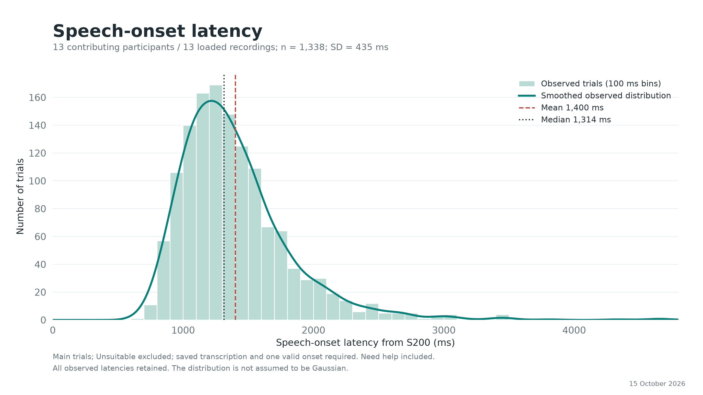
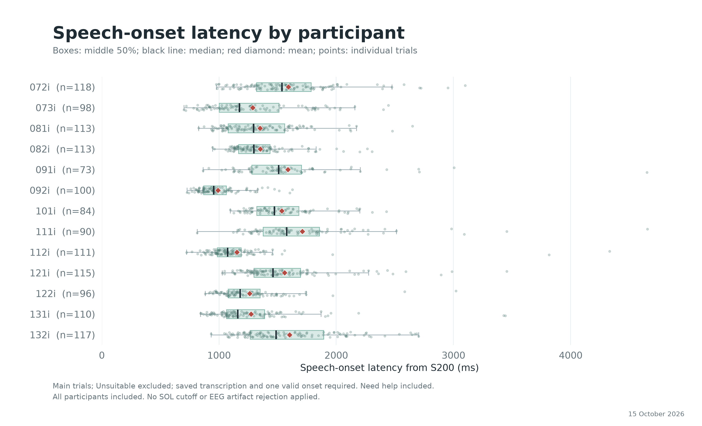
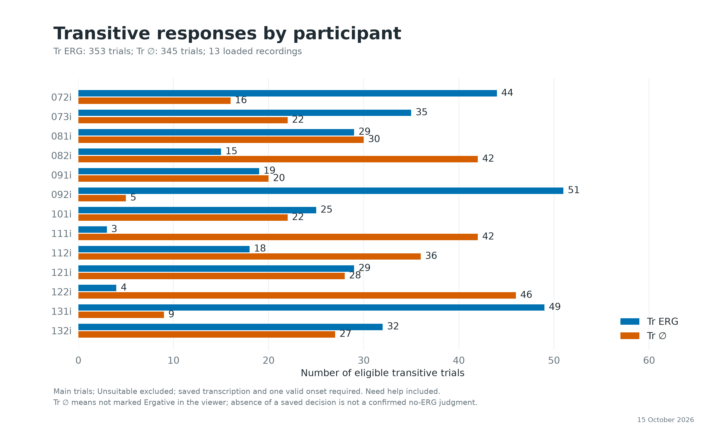
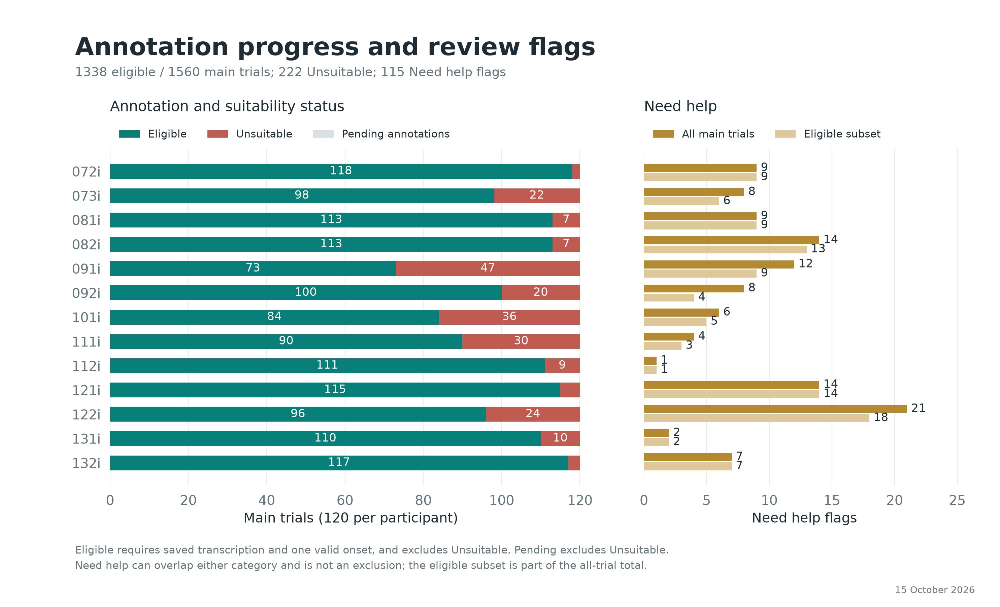
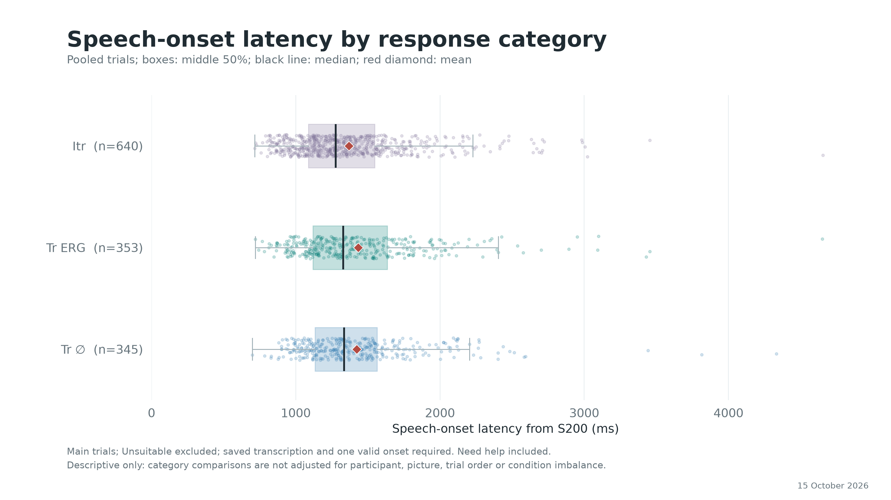
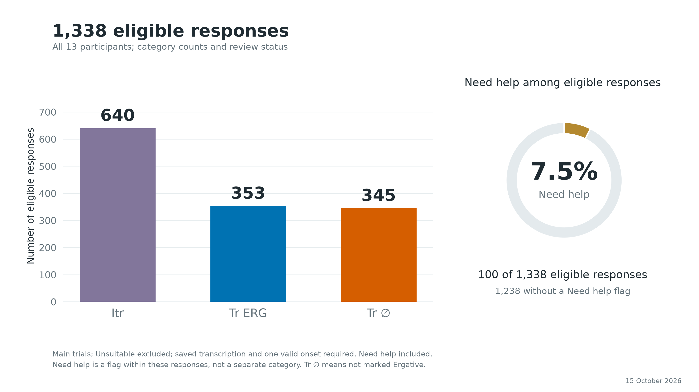

# Lab Seminar: Descriptive Statistics

Snapshot: 15 October 2026.

## Counting Rules

All 13 loaded recordings are included. Main trials only; practice and session events are excluded. SOL = annotated acoustic speech onset minus S200, in milliseconds. Eligible trials have nonblank saved transcription, exactly one valid speech onset, and are not marked Unsuitable. Need help remains included. No SOL cutoff, outlier trimming, participant exclusion, or EEG artifact rejection was applied.

Tr ERG means marked Ergative. Tr zero (Tr ∅) means not marked Ergative; a missing saved decision is not independent confirmation that case marking was absent.

## Overall

- Participants: 13; recorded main trials: 1560.
- Transcribed: 1560; valid single onset: 1558; eligible: 1338.
- Unsuitable: 222; pending annotations among non-Unsuitable trials: 0.
- Need help: 115 / 1560 main trials (7.4%); 100 / 1338 eligible trials (7.5%). Need help and Unsuitable overlap on 15 trials.
- Eligible categories: Itr 640; Tr ERG 353; Tr ∅ 345.
- Trial-weighted SOL: mean 1399.8 ms; median 1313.6 ms; SD 435.2 ms.
- SOL middle 50%: 1113.8-1567.6 ms; range 699.4-4654.8 ms.
- Equal-weight mean of participant mean SOLs: 1404.1 ms.

SD above describes trials, not uncertainty of the group mean. No inferential test or Gaussian assumption is used.

## Participant Summary

| Participant | Transcribed | Eligible | Itr | Tr ERG | Tr ∅ | Unsuitable | Need help (all) | Need help (eligible) | Mean SOL (ms) | Median SOL (ms) |
|---|---:|---:|---:|---:|---:|---:|---:|---:|---:|---:|
| 072i | 120/120 | 118 | 58 | 44 | 16 | 2 | 9 | 9 | 1591 | 1536 |
| 073i | 120/120 | 98 | 41 | 35 | 22 | 22 | 8 | 6 | 1287 | 1175 |
| 081i | 120/120 | 113 | 54 | 29 | 30 | 7 | 9 | 9 | 1350 | 1295 |
| 082i | 120/120 | 113 | 56 | 15 | 42 | 7 | 14 | 13 | 1352 | 1298 |
| 091i | 120/120 | 73 | 34 | 19 | 20 | 47 | 12 | 9 | 1588 | 1509 |
| 092i | 120/120 | 100 | 44 | 51 | 5 | 20 | 8 | 4 | 992 | 955 |
| 101i | 120/120 | 84 | 37 | 25 | 22 | 36 | 6 | 5 | 1536 | 1472 |
| 111i | 120/120 | 90 | 45 | 3 | 42 | 30 | 4 | 3 | 1711 | 1577 |
| 112i | 120/120 | 111 | 57 | 18 | 36 | 9 | 1 | 1 | 1151 | 1073 |
| 121i | 120/120 | 115 | 58 | 29 | 28 | 5 | 14 | 14 | 1560 | 1460 |
| 122i | 120/120 | 96 | 46 | 4 | 46 | 24 | 21 | 18 | 1260 | 1181 |
| 131i | 120/120 | 110 | 52 | 49 | 9 | 10 | 2 | 2 | 1272 | 1161 |
| 132i | 120/120 | 117 | 58 | 32 | 27 | 3 | 7 | 7 | 1602 | 1486 |

## SOL by Category

| Category | n | Mean (ms) | Median (ms) | SD (ms) |
|---|---:|---:|---:|---:|
| Itr | 640 | 1369.2 | 1277.5 | 424.5 |
| Tr ERG | 353 | 1433.0 | 1329.9 | 464.4 |
| Tr ∅ | 345 | 1422.5 | 1335.9 | 420.8 |

## Timing Eligibility

These are timing counts only, not evidence of artifact-free EEG. For example, SOL >=1000 ms allows 600 ms plus a nominal 400 ms pre-speech gap; >=1200 ms allows 800 + 400 ms; >=1400 ms allows 800 + 600 ms. The gap still needs validation.

| Minimum SOL (ms) | Retained | Retained (%) | Below threshold | Itr | Tr ERG | Tr ∅ |
|---|---:|---:|---:|---:|---:|---:|
| 1000 | 1163 | 86.9 | 175 | 541 | 308 | 314 |
| 1100 | 1023 | 76.5 | 315 | 473 | 273 | 277 |
| 1200 | 860 | 64.3 | 478 | 397 | 229 | 234 |
| 1250 | 788 | 58.9 | 550 | 354 | 213 | 221 |
| 1400 | 543 | 40.6 | 795 | 238 | 153 | 152 |

## Annotation Checks

Missing transcription and missing/multiple onset counts can overlap, and include Unsuitable trials. Unassigned speech-tier points can include deliberately added resting-state marks; they are preserved and not silently attached to trials.

| Participant | No transcription | No onset | Multiple onsets | Unassigned points | Unassigned text intervals |
|---|---:|---:|---:|---:|---:|
| 072i | 0 | 0 | 0 | 0 | 0 |
| 073i | 0 | 0 | 0 | 0 | 0 |
| 081i | 0 | 0 | 0 | 0 | 0 |
| 082i | 0 | 0 | 0 | 0 | 0 |
| 091i | 0 | 0 | 1 | 0 | 0 |
| 092i | 0 | 0 | 0 | 0 | 0 |
| 101i | 0 | 0 | 1 | 0 | 0 |
| 111i | 0 | 0 | 0 | 0 | 0 |
| 112i | 0 | 0 | 0 | 0 | 0 |
| 121i | 0 | 0 | 0 | 0 | 0 |
| 122i | 0 | 0 | 0 | 0 | 0 |
| 131i | 0 | 0 | 0 | 0 | 0 |
| 132i | 0 | 0 | 0 | 0 | 0 |

Trials with multiple onset marks:

- 091i, main-031, S 110: 2 onset marks; already marked Unsuitable.
- 101i, main-001, S 95: 2 onset marks; already marked Unsuitable.

## Figures

## Reproducibility

Source: saved Praat TextGrids and recording-scoped trial decisions in the local reference interface. The source snapshot, source hashes, all-trial rows and summary JSON accompany this report. Charts describe this frozen snapshot and do not update automatically. Original annotations and flags were not edited.
