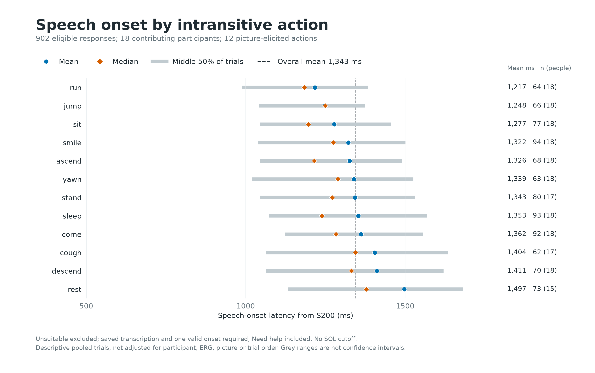
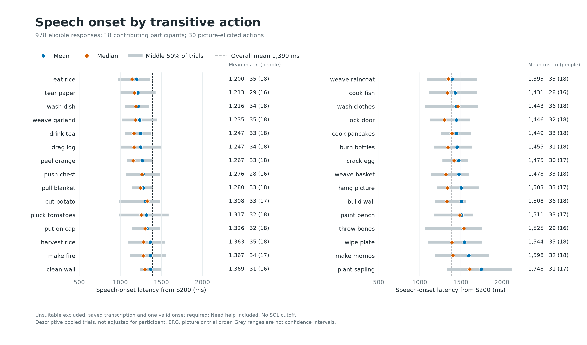

# Speech Onset by Picture-Elicited Action

Frozen cohort: 2026-10-20T22:11:42.094901+00:00.

SOL = saved acoustic speech onset minus S200. Eligible main trials only; Unsuitable excluded; transcription and one valid onset required; Need help included. All contributing participants included; no timing exclusions.

Actions describe the pictures, not a guaranteed spoken verb. Pooled means/medians are descriptive. Picture, participant, ERG marking, noun choice and trial order can differ across actions. Only one or two eligible examples of an action usually remain per person. No causal claim, significance test or normality assumption is made.

Participant-centering subtracts each participant's mean within transitivity, averages these residuals per action, then adds the pooled transitivity mean. This is a descriptive check, not a fully adjusted model or independent effect estimate. Extreme-action contrasts below were selected after inspecting the means and are not confirmatory comparisons.

## Intransitive

| Action | n | People | Mean ms | Median ms | Q1 ms | Q3 ms | Participant-centered mean ms |
|---|---:|---:|---:|---:|---:|---:|---:|
| run | 64 | 18 | 1217.1 | 1183.4 | 989.3 | 1381.9 | 1216.5 |
| jump | 66 | 18 | 1248.2 | 1249.4 | 1042.1 | 1374.9 | 1252.5 |
| sit | 77 | 18 | 1277.2 | 1196.4 | 1045.2 | 1455.8 | 1281.9 |
| smile | 94 | 18 | 1321.6 | 1274.2 | 1038.4 | 1501.1 | 1315.7 |
| ascend | 68 | 18 | 1325.9 | 1214.8 | 1044.8 | 1490.5 | 1332.3 |
| yawn | 63 | 18 | 1339.4 | 1288.8 | 1020.5 | 1525.7 | 1349.2 |
| stand | 80 | 17 | 1342.7 | 1270.7 | 1044.9 | 1530.9 | 1324.9 |
| sleep | 93 | 18 | 1353.2 | 1238.7 | 1072.6 | 1567.5 | 1348.4 |
| come | 92 | 18 | 1361.5 | 1282.8 | 1123.8 | 1555.0 | 1363.9 |
| cough | 62 | 17 | 1404.4 | 1343.8 | 1063.5 | 1633.8 | 1421.6 |
| descend | 70 | 18 | 1411.2 | 1331.2 | 1064.6 | 1620.3 | 1405.9 |
| rest | 73 | 15 | 1497.3 | 1377.8 | 1133.2 | 1681.0 | 1495.2 |

In 14/15 participants with usable responses for both run and rest, the participant's mean was longer for rest.

## Transitive

| Action | n | People | Mean ms | Median ms | Q1 ms | Q3 ms | Participant-centered mean ms |
|---|---:|---:|---:|---:|---:|---:|---:|
| eat rice | 35 | 18 | 1199.5 | 1143.8 | 970.0 | 1357.4 | 1186.6 |
| tear paper | 29 | 16 | 1212.9 | 1175.0 | 1000.5 | 1429.2 | 1256.0 |
| wash dish | 34 | 18 | 1215.7 | 1189.6 | 1057.0 | 1351.1 | 1217.7 |
| weave garland | 35 | 18 | 1235.0 | 1187.7 | 1021.5 | 1444.0 | 1232.1 |
| drink tea | 33 | 18 | 1246.7 | 1162.8 | 1053.6 | 1368.4 | 1245.8 |
| drag log | 34 | 18 | 1247.5 | 1166.7 | 1007.8 | 1496.9 | 1236.8 |
| peel orange | 33 | 18 | 1266.9 | 1156.6 | 1077.6 | 1391.0 | 1268.7 |
| push chest | 28 | 16 | 1275.9 | 1264.8 | 1071.9 | 1486.1 | 1315.6 |
| pull blanket | 33 | 18 | 1280.3 | 1246.5 | 1143.8 | 1390.8 | 1286.9 |
| cut potato | 33 | 17 | 1307.5 | 1328.5 | 983.0 | 1479.1 | 1299.7 |
| pluck tomatoes | 32 | 18 | 1317.1 | 1253.3 | 981.2 | 1586.3 | 1315.7 |
| put on cap | 32 | 18 | 1326.1 | 1304.2 | 1138.0 | 1484.8 | 1342.8 |
| harvest rice | 35 | 18 | 1362.8 | 1283.6 | 1091.0 | 1544.3 | 1350.7 |
| make fire | 34 | 17 | 1366.6 | 1278.5 | 1114.0 | 1556.1 | 1370.2 |
| clean wall | 31 | 16 | 1369.3 | 1298.1 | 1237.3 | 1494.8 | 1370.4 |
| weave raincoat | 35 | 18 | 1395.4 | 1348.8 | 1094.1 | 1694.6 | 1382.5 |
| cook fish | 28 | 16 | 1430.5 | 1340.1 | 1114.5 | 1701.2 | 1451.6 |
| wash clothes | 36 | 18 | 1443.2 | 1468.5 | 1065.4 | 1703.6 | 1432.3 |
| lock door | 32 | 18 | 1446.3 | 1302.1 | 1120.3 | 1608.3 | 1454.7 |
| cook pancakes | 33 | 18 | 1448.5 | 1388.6 | 1258.3 | 1627.6 | 1429.6 |
| burn bottles | 31 | 18 | 1454.8 | 1343.4 | 1174.4 | 1642.4 | 1419.3 |
| crack egg | 30 | 17 | 1474.7 | 1420.4 | 1276.2 | 1586.4 | 1482.1 |
| weave basket | 33 | 18 | 1477.8 | 1318.9 | 1133.9 | 1602.6 | 1459.0 |
| hang picture | 33 | 17 | 1503.1 | 1337.4 | 1207.8 | 1719.3 | 1503.7 |
| build wall | 36 | 18 | 1507.9 | 1330.3 | 1191.6 | 1558.7 | 1497.0 |
| paint bench | 33 | 17 | 1510.5 | 1489.7 | 1169.5 | 1651.5 | 1515.4 |
| throw bones | 29 | 16 | 1524.8 | 1534.2 | 1067.6 | 1754.3 | 1532.6 |
| wipe plate | 35 | 18 | 1544.3 | 1391.6 | 1099.1 | 1761.2 | 1538.9 |
| make momos | 32 | 18 | 1597.7 | 1403.1 | 1185.0 | 1845.6 | 1614.3 |
| plant sapling | 31 | 17 | 1747.6 | 1607.4 | 1333.4 | 2123.9 | 1748.9 |

In 16/17 participants with usable responses for both eat rice and plant sapling, the participant's mean was longer for plant sapling.

## Figures

