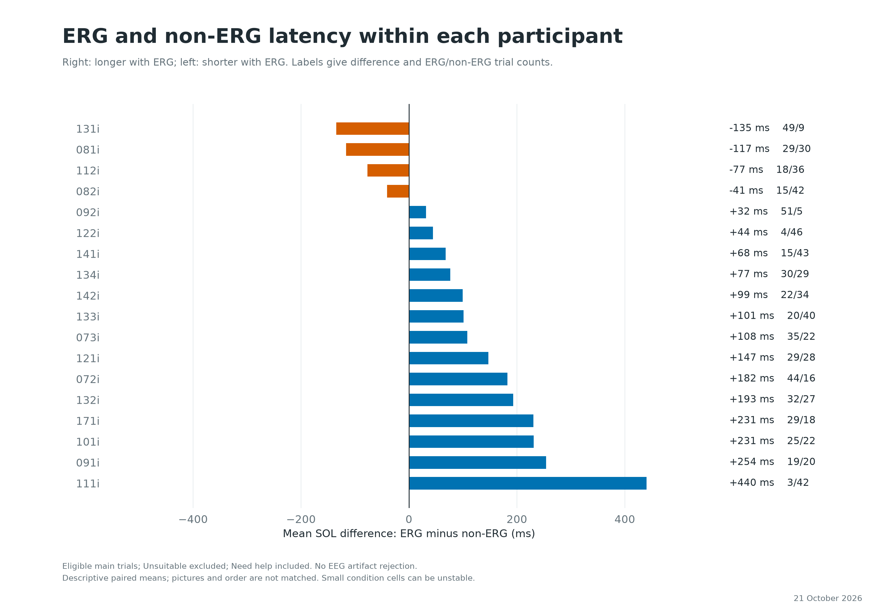
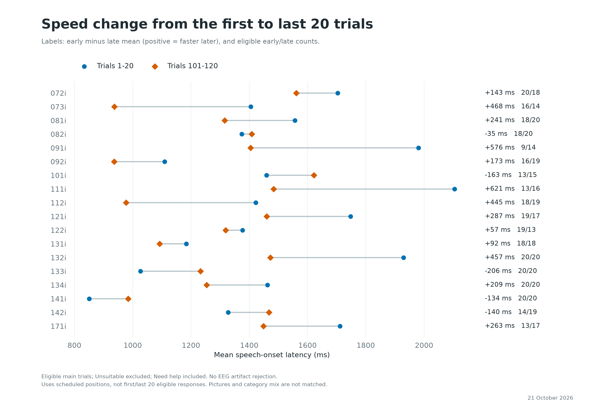
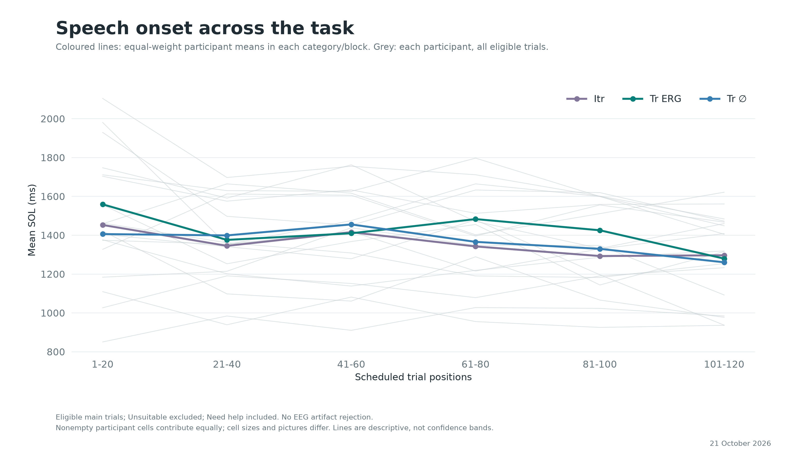
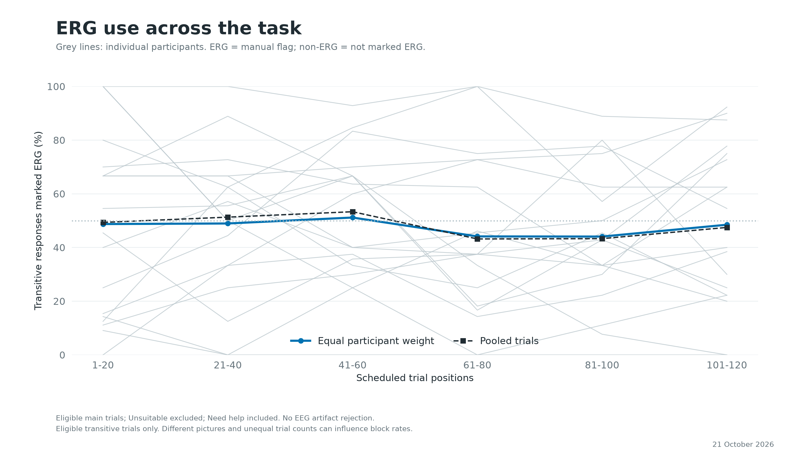
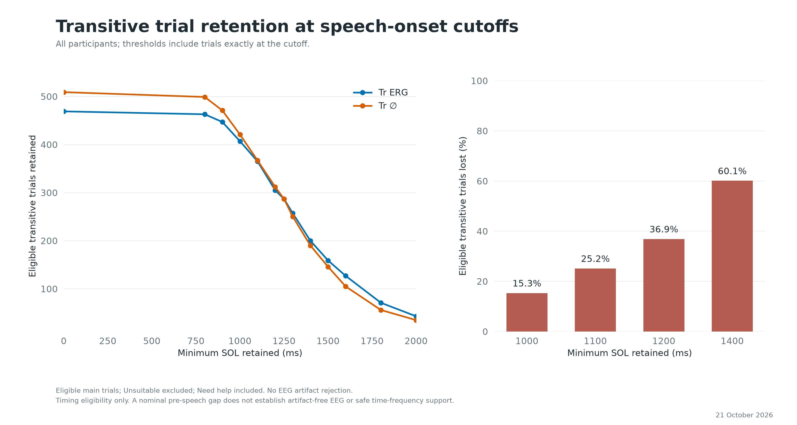
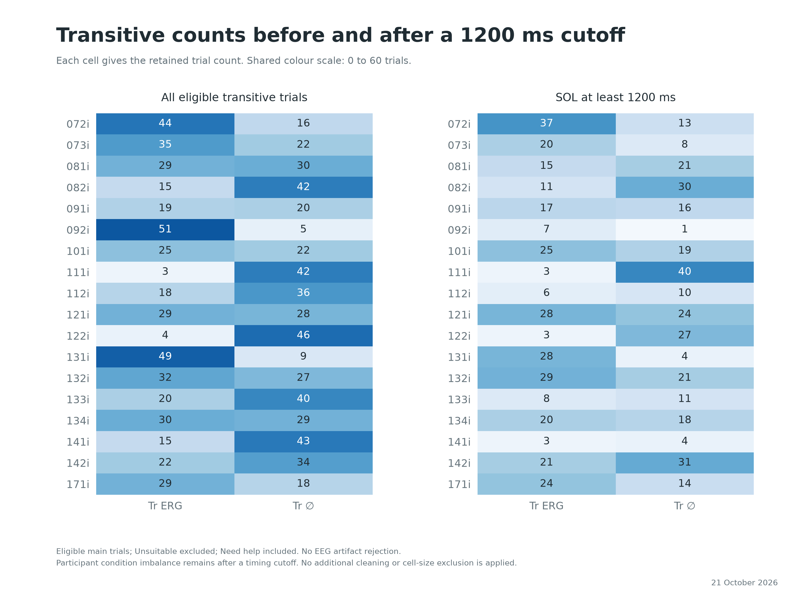
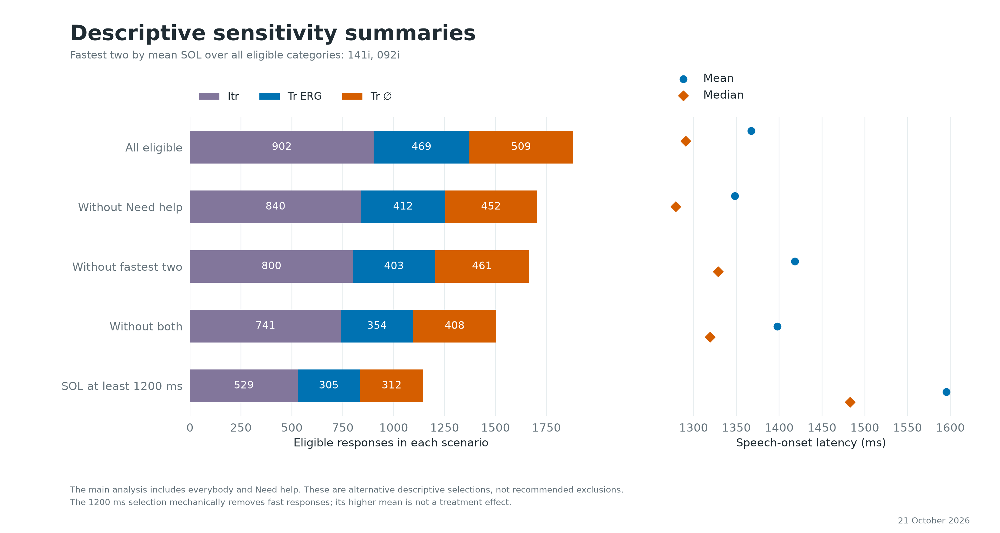
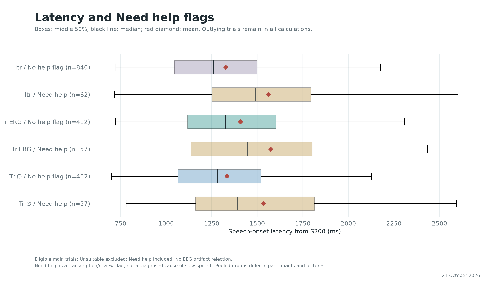
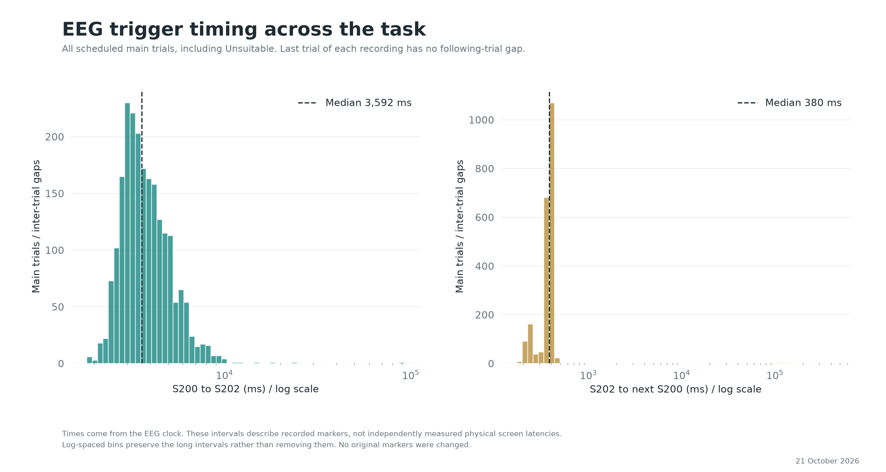

# Extended Descriptive Report

Snapshot date (Europe/Zurich): 21 October 2026
UTC source timestamp: 2026-10-20T22:11:42.094901+00:00

## Scope and Definitions

Main trials with saved nonblank transcription, exactly one valid speech onset and no Unsuitable flag are eligible. Need help is included. SOL is acoustic onset minus EEG S200. No EEG artifact rejection or timing/participant exclusion is applied unless a specific sensitivity row says otherwise. There is no subtraction of a PsychoPy clock offset.

ERG means the manual flag; non-ERG means not marked ERG, including missing saved decisions. Noun and indefinite-marker coding is provisional, not a validated parser. No indefinite marker is not labelled definite. This report is descriptive and exploratory: no significance tests, automatic preferred model, causal claims or multiple-comparison fishing.

## Recording Coverage and Quality

18 contributing participants, 1880 eligible responses. Total recorded EEG duration, including practice and other periods: 7.05 hours.

| Type | Scheduled | Eligible | Eligible (%) | Unsuitable | Need help (all) | Need help (eligible) |
|---|---|---|---|---|---|---|
| Itr | 1080 | 902 | 83.5 | 178 | 74 | 62 |
| Transitive | 1080 | 978 | 90.6 | 102 | 121 | 114 |

## Category Latencies

| Category | n | Mean ms | Median ms | SD ms | Q1 ms | Q3 ms | Equal-person mean ms | Need help (%) |
|---|---|---|---|---|---|---|---|---|
| Itr | 902 | 1342.7 | 1268.7 | 420.3 | 1051.2 | 1527.8 | 1350.3 | 6.9 |
| Tr ERG | 469 | 1427.8 | 1332.4 | 458.3 | 1125.8 | 1634.5 | 1461.6 | 12.2 |
| Tr ∅ | 509 | 1355.8 | 1295.8 | 414.0 | 1075.2 | 1541.3 | 1359.4 | 11.2 |

Pooled means weight trials equally. Equal-person means first average within each participant and category. Neither controls pictures or trial order; SD describes trial variability, not uncertainty of a group mean.

## ERG versus Non-ERG Within Participants

Equal-weight mean of 18 participant mean differences (ERG minus non-ERG): 102.2 ms. Median participant difference: 100.2 ms. ERG is slower in 14/18 participants.

| Participant | ERG n | Non-ERG n | ERG mean ms | Non-ERG mean ms | Mean difference ms | Median difference ms |
|---|---|---|---|---|---|---|
| 072i | 44 | 16 | 1638.0 | 1455.5 | 182.5 | 65.6 |
| 073i | 35 | 22 | 1331.7 | 1223.3 | 108.4 | 196.8 |
| 081i | 29 | 30 | 1296.1 | 1412.7 | -116.6 | -159.4 |
| 082i | 15 | 42 | 1339.9 | 1380.6 | -40.6 | 13.2 |
| 091i | 19 | 20 | 1776.5 | 1522.5 | 254.0 | 93.0 |
| 092i | 51 | 5 | 1020.3 | 988.6 | 31.7 | 82.4 |
| 101i | 25 | 22 | 1672.7 | 1441.7 | 231.1 | 77.8 |
| 111i | 3 | 42 | 2091.9 | 1651.5 | 440.4 | 312.0 |
| 112i | 18 | 36 | 1195.0 | 1271.9 | -76.9 | 41.6 |
| 121i | 29 | 28 | 1719.7 | 1572.8 | 147.0 | 81.7 |
| 122i | 4 | 46 | 1369.7 | 1325.2 | 44.5 | 132.3 |
| 131i | 49 | 9 | 1337.7 | 1472.6 | -134.9 | 160.2 |
| 132i | 32 | 27 | 1662.6 | 1469.6 | 193.0 | 233.5 |
| 133i | 20 | 40 | 1229.1 | 1128.0 | 101.1 | 127.6 |
| 134i | 30 | 29 | 1341.1 | 1264.3 | 76.8 | 110.7 |
| 141i | 15 | 43 | 1019.9 | 952.2 | 67.8 | 36.3 |
| 142i | 22 | 34 | 1584.7 | 1485.3 | 99.3 | 56.0 |
| 171i | 29 | 18 | 1682.5 | 1451.7 | 230.8 | 160.3 |

Small condition cells are shown, not silently excluded. The following checks restrict both cells to the stated minimum; they are descriptive sensitivity summaries, not validated minimum sample-size recommendations.

| Minimum trials each | Participants | Mean difference ms |
|---|---|---|
| 1 | 18 | 102.2 |
| 5 | 16 | 84.7 |
| 10 | 14 | 104.1 |
| 15 | 14 | 104.1 |
| 20 | 8 | 105.0 |
| 25 | 4 | 75.0 |
| 30 | 0 | n.a. |

## Speed Change Across the Task

Early means use eligible trials at scheduled positions 1-20; late means use positions 101-120. Positive early-minus-late values mean speeding up. These are not picture-matched comparisons.

| Selection | Participants | Faster later | Mean speedup ms | Median speedup ms | Mean speedup (%) |
|---|---|---|---|---|---|
| All | 18 | 13 | 186.3 | 190.9 | 10.2 |
| Itr | 18 | 12 | 156.1 | 98.0 | 8.1 |
| Transitive | 18 | 13 | 197.7 | 217.7 | 10.5 |

| Participant | Early n | Late n | Early mean ms | Late mean ms | Speedup ms | Speedup (%) | Slope ms / 100 trials |
|---|---|---|---|---|---|---|---|
| 072i | 20 | 18 | 1703.6 | 1561.0 | 142.6 | 8.4 | -144.3 |
| 073i | 16 | 14 | 1404.9 | 937.0 | 467.8 | 33.3 | -344.3 |
| 081i | 18 | 20 | 1556.7 | 1316.0 | 240.7 | 15.5 | -173.0 |
| 082i | 18 | 20 | 1374.0 | 1408.7 | -34.7 | -2.5 | -6.3 |
| 091i | 9 | 14 | 1980.8 | 1404.7 | 576.2 | 29.1 | -376.7 |
| 092i | 16 | 19 | 1109.6 | 936.3 | 173.3 | 15.6 | -156.6 |
| 101i | 13 | 15 | 1458.9 | 1621.6 | -162.7 | -11.2 | 33.5 |
| 111i | 13 | 16 | 2104.5 | 1483.9 | 620.6 | 29.5 | -510.1 |
| 112i | 18 | 19 | 1422.0 | 977.3 | 444.8 | 31.3 | -344.7 |
| 121i | 19 | 17 | 1747.5 | 1460.2 | 287.3 | 16.4 | -352.7 |
| 122i | 19 | 13 | 1376.6 | 1319.1 | 57.4 | 4.2 | -18.8 |
| 131i | 18 | 18 | 1184.0 | 1092.3 | 91.7 | 7.7 | -43.4 |
| 132i | 20 | 20 | 1929.6 | 1472.7 | 457.0 | 23.7 | -248.6 |
| 133i | 20 | 20 | 1026.4 | 1232.9 | -206.4 | -20.1 | 148.5 |
| 134i | 20 | 20 | 1462.5 | 1254.0 | 208.5 | 14.3 | -244.1 |
| 141i | 20 | 20 | 850.6 | 984.2 | -133.6 | -15.7 | 127.9 |
| 142i | 14 | 19 | 1327.3 | 1467.6 | -140.4 | -10.6 | 17.3 |
| 171i | 13 | 17 | 1711.2 | 1448.7 | 262.5 | 15.3 | -207.9 |

## Timing Cutoffs

| Minimum SOL ms | Itr | Tr ERG | Tr non-ERG | Transitive retained | Transitive lost (%) | People with 10 each | People with 20 each |
|---|---|---|---|---|---|---|---|
| 0 | 902 | 469 | 509 | 978 | 0.0 | 14 | 8 |
| 800 | 889 | 463 | 499 | 962 | 1.6 | 14 | 7 |
| 900 | 813 | 447 | 471 | 918 | 6.1 | 14 | 6 |
| 1000 | 729 | 407 | 421 | 828 | 15.3 | 13 | 6 |
| 1100 | 630 | 365 | 367 | 732 | 25.2 | 13 | 6 |
| 1200 | 529 | 305 | 312 | 617 | 36.9 | 10 | 3 |
| 1250 | 473 | 287 | 287 | 574 | 41.3 | 10 | 2 |
| 1300 | 412 | 257 | 250 | 507 | 48.2 | 9 | 1 |
| 1400 | 317 | 200 | 190 | 390 | 60.1 | 5 | 0 |
| 1500 | 240 | 159 | 146 | 305 | 68.8 | 5 | 0 |
| 1600 | 183 | 127 | 105 | 232 | 76.3 | 0 | 0 |
| 1800 | 103 | 71 | 56 | 127 | 87.0 | 0 | 0 |
| 2000 | 64 | 43 | 35 | 78 | 92.0 | 0 | 0 |

All thresholds are inclusive (SOL >= cutoff). Counts alone do not establish artifact-free EEG. A fixed acoustic buffer does not account for earlier EMG, filtering or time-frequency kernels reaching into later data. The present report does not choose an EEG analysis window or buffer.

## Sensitivity Selections

The fastest two were selected post hoc by their mean across all eligible categories: 141i, 092i. This is a descriptive sensitivity check, not an exclusion recommendation. Thresholding SOL mechanically raises its conditional mean.

| Selection | n | People | Mean ms | Median ms | Itr | Tr ERG | Tr non-ERG |
|---|---|---|---|---|---|---|---|
| All eligible | 1880 | 18 | 1367.5 | 1290.8 | 902 | 469 | 509 |
| Without Need help | 1704 | 18 | 1348.0 | 1279.0 | 840 | 412 | 452 |
| Without fastest two | 1664 | 16 | 1418.3 | 1328.6 | 800 | 403 | 461 |
| Without both | 1503 | 16 | 1397.8 | 1319.2 | 741 | 354 | 408 |
| SOL at least 1200 ms | 1146 | 18 | 1595.4 | 1482.8 | 529 | 305 | 312 |

| Selection | Pooled ERG minus non-ERG ms | Paired people | Equal-person difference ms |
|---|---|---|---|
| All eligible | 72.0 | 18 | 102.2 |
| Without Need help | 74.2 | 18 | 130.4 |
| Without fastest two | 97.1 | 16 | 108.7 |
| Without both | 96.2 | 16 | 139.1 |
| SOL at least 1200 ms | 63.9 | 18 | 13.0 |

## Need Help and Latency

| Category | Need help flag | n | Mean ms | Median ms |
|---|---|---|---|---|
| All | False | 1704 | 1348.0 | 1279.0 |
| All | True | 176 | 1555.4 | 1444.7 |
| Itr | False | 840 | 1326.6 | 1259.2 |
| Itr | True | 62 | 1560.4 | 1492.0 |
| Tr ERG | False | 412 | 1407.7 | 1325.4 |
| Tr ERG | True | 57 | 1572.9 | 1449.1 |
| Tr ∅ | False | 452 | 1333.6 | 1281.9 |
| Tr ∅ | True | 57 | 1532.5 | 1393.8 |

Need help marks transcription/review uncertainty. These groups differ in pictures and participants; no cause of longer/shorter speech is inferred. The CSV also provides paired within-participant descriptive differences where both review groups occur.

## ERG Switching

A valid pair consists of two consecutive scheduled transitive trials with both eligible; intervening intransitives are ignored. An excluded transitive breaks a pair. Switching is merely observed category change, not a test of randomness or switching cost.

| Participant | Valid pairs | Changes | Changes (%) |
|---|---|---|---|
| 072i | 59 | 25 | 42.4 |
| 073i | 53 | 21 | 39.6 |
| 081i | 57 | 22 | 38.6 |
| 082i | 54 | 17 | 31.5 |
| 091i | 29 | 10 | 34.5 |
| 092i | 51 | 5 | 9.8 |
| 101i | 40 | 22 | 55.0 |
| 111i | 34 | 6 | 17.6 |
| 112i | 47 | 19 | 40.4 |
| 121i | 53 | 19 | 35.8 |
| 122i | 41 | 6 | 14.6 |
| 131i | 55 | 14 | 25.5 |
| 132i | 57 | 27 | 47.4 |
| 133i | 59 | 20 | 33.9 |
| 134i | 57 | 26 | 45.6 |
| 141i | 55 | 23 | 41.8 |
| 142i | 51 | 13 | 25.5 |
| 171i | 36 | 15 | 41.7 |

## Trigger Intervals

| Interval | n | Mean ms | Median ms | Minimum ms | Maximum ms |
|---|---|---|---|---|---|
| s200_to_s202_ms | 2160 | 3990.5 | 3592.4 | 1839.8 | 91758.1 |
| s202_to_next_s200_ms | 2142 | 1464.1 | 379.9 | 172.2 | 432142.0 |
| s200_to_condition_code_ms | 2160 | 218.2 | 218.0 | 207.5 | 237.8 |
| s200_to_item_code_ms | 2160 | 418.2 | 418.1 | 407.4 | 435.1 |

These marker intervals are all on the EEG clock. The gap distribution includes long pauses/breaks: its median and quartiles describe ordinary transitions better than its mean. Long intervals are retained, not diagnosed as missing markers or behavioural errors. They do not measure physical picture/display latency or a clock offset. The final trial of each participant is excluded only from the next-trial-gap statistic.

## Provisional Yield Projection

For the previously discussed planning target of 800 eligible ERG plus 800 eligible non-ERG trials, the following projects total participants using average observed yield. Assumes the same population, protocol and condition/rejection distribution. Additional EEG rejection is applied equally to existing and future trials. These are expected-yield calculations, not a power analysis, a guaranteed yield, or evidence that 800 trials suffice for inference.

| Minimum SOL ms | Further EEG rejection fraction | Projected total people |
|---|---|---|
| 0 | 0 | 31 |
| 0 | 0.1 | 35 |
| 0 | 0.2 | 39 |
| 1000 | 0 | 36 |
| 1000 | 0.1 | 40 |
| 1000 | 0.2 | 45 |
| 1200 | 0 | 48 |
| 1200 | 0.1 | 53 |
| 1200 | 0.2 | 60 |
| 1400 | 0 | 76 |
| 1400 | 0.1 | 85 |
| 1400 | 0.2 | 95 |

## Additional Tables

The CSVs include participant-level category counts, timing-cell sizes, trial blocks, Need help contrasts, item-by-list summaries and coding cases needing review. The item table separates experiment lists and stimulus/image versions rather than assuming that an S-number names the same picture across lists. Token counts are not used as validated linguistic lengths.

## Figures

