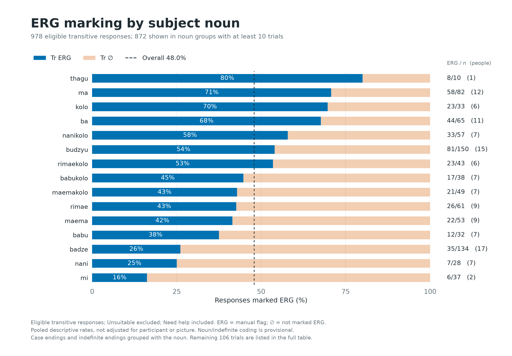
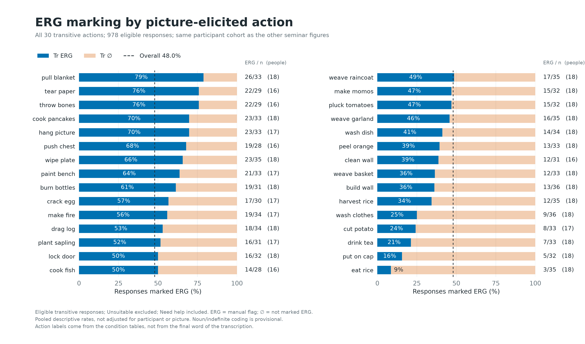
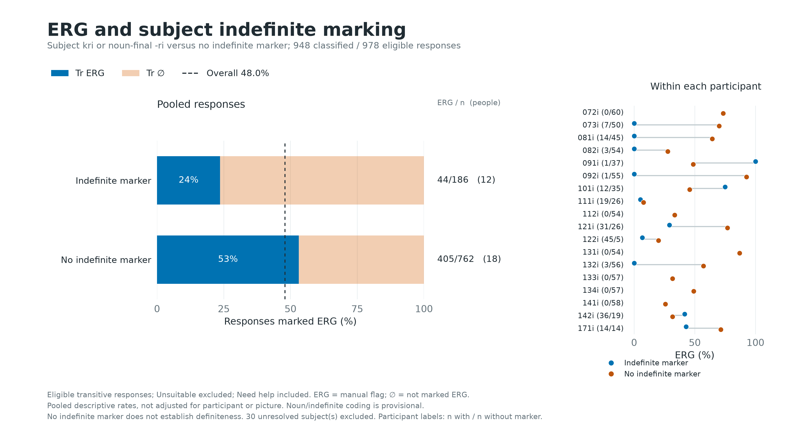

# Lab Seminar: Descriptive Statistics

Snapshot: 21 October 2026.

## Counting Rules

All 18 loaded recordings are included. Main trials only; practice and session events are excluded. SOL = annotated acoustic speech onset minus S200, in milliseconds. Eligible trials have nonblank saved transcription, exactly one valid speech onset, and are not marked Unsuitable. Need help remains included. No SOL cutoff, outlier trimming, participant exclusion, or EEG artifact rejection was applied.

Tr ERG means marked Ergative. Tr zero (Tr ∅) means not marked Ergative; a missing saved decision is not independent confirmation that case marking was absent.

## Overall

- Participants: 18; recorded main trials: 2160.
- Transcribed: 2160; valid single onset: 2158; eligible: 1880.
- Unsuitable: 280; pending annotations among non-Unsuitable trials: 0.
- Need help: 195 / 2160 main trials (9.0%); 176 / 1880 eligible trials (9.4%). Need help and Unsuitable overlap on 19 trials.
- Eligible categories: Itr 902; Tr ERG 469; Tr ∅ 509.
- Trial-weighted SOL: mean 1367.5 ms; median 1290.8 ms; SD 429.6 ms.
- SOL middle 50%: 1076.8-1552.2 ms; range 699.4-4654.8 ms.
- Equal-weight mean of participant mean SOLs: 1376.8 ms.

SD above describes trials, not uncertainty of the group mean. No inferential test or Gaussian assumption is used.

## Participant Summary

| Participant | Transcribed | Eligible | Itr | Tr ERG | Tr ∅ | Unsuitable | Need help (all) | Need help (eligible) | Mean SOL (ms) | Median SOL (ms) |
|---|---:|---:|---:|---:|---:|---:|---:|---:|---:|---:|
| 072i | 120/120 | 118 | 58 | 44 | 16 | 2 | 9 | 9 | 1591 | 1536 |
| 073i | 120/120 | 98 | 41 | 35 | 22 | 22 | 8 | 6 | 1287 | 1175 |
| 081i | 120/120 | 113 | 54 | 29 | 30 | 7 | 9 | 9 | 1350 | 1295 |
| 082i | 120/120 | 113 | 56 | 15 | 42 | 7 | 14 | 13 | 1352 | 1298 |
| 091i | 120/120 | 73 | 34 | 19 | 20 | 47 | 12 | 9 | 1588 | 1509 |
| 092i | 120/120 | 100 | 44 | 51 | 5 | 20 | 8 | 4 | 992 | 955 |
| 101i | 120/120 | 84 | 37 | 25 | 22 | 36 | 6 | 5 | 1536 | 1472 |
| 111i | 120/120 | 90 | 45 | 3 | 42 | 30 | 4 | 3 | 1711 | 1577 |
| 112i | 120/120 | 111 | 57 | 18 | 36 | 9 | 1 | 1 | 1151 | 1073 |
| 121i | 120/120 | 115 | 58 | 29 | 28 | 5 | 14 | 14 | 1560 | 1460 |
| 122i | 120/120 | 96 | 46 | 4 | 46 | 24 | 21 | 18 | 1260 | 1181 |
| 131i | 120/120 | 110 | 52 | 49 | 9 | 10 | 2 | 2 | 1272 | 1161 |
| 132i | 120/120 | 117 | 58 | 32 | 27 | 3 | 7 | 7 | 1602 | 1486 |
| 133i | 120/120 | 113 | 53 | 20 | 40 | 7 | 8 | 7 | 1144 | 972 |
| 134i | 120/120 | 118 | 59 | 30 | 29 | 2 | 3 | 3 | 1295 | 1275 |
| 141i | 120/120 | 116 | 58 | 15 | 43 | 4 | 11 | 11 | 963 | 915 |
| 142i | 120/120 | 104 | 48 | 22 | 34 | 16 | 19 | 18 | 1499 | 1440 |
| 171i | 120/120 | 91 | 44 | 29 | 18 | 29 | 39 | 37 | 1629 | 1416 |

## SOL by Category

| Category | n | Mean (ms) | Median (ms) | SD (ms) |
|---|---:|---:|---:|---:|
| Itr | 902 | 1342.7 | 1268.7 | 420.3 |
| Tr ERG | 469 | 1427.8 | 1332.4 | 458.3 |
| Tr ∅ | 509 | 1355.8 | 1295.8 | 414.0 |

## Timing Eligibility

These are timing counts only, not evidence of artifact-free EEG. For example, SOL >=1000 ms allows 600 ms plus a nominal 400 ms pre-speech gap; >=1200 ms allows 800 + 400 ms; >=1400 ms allows 800 + 600 ms. The gap still needs validation.

| Minimum SOL (ms) | Retained | Retained (%) | Below threshold | Itr | Tr ERG | Tr ∅ |
|---|---:|---:|---:|---:|---:|---:|
| 1000 | 1557 | 82.8 | 323 | 729 | 407 | 421 |
| 1100 | 1362 | 72.4 | 518 | 630 | 365 | 367 |
| 1200 | 1146 | 61.0 | 734 | 529 | 305 | 312 |
| 1250 | 1047 | 55.7 | 833 | 473 | 287 | 287 |
| 1400 | 707 | 37.6 | 1173 | 317 | 200 | 190 |

## Annotation Checks

Missing transcription and missing/multiple onset counts can overlap, and include Unsuitable trials. Unassigned speech-tier points can include deliberately added resting-state marks; they are preserved and not silently attached to trials.

| Participant | No transcription | No onset | Multiple onsets | Unassigned points | Unassigned text intervals |
|---|---:|---:|---:|---:|---:|
| 072i | 0 | 0 | 0 | 0 | 0 |
| 073i | 0 | 0 | 0 | 0 | 0 |
| 081i | 0 | 0 | 0 | 0 | 0 |
| 082i | 0 | 0 | 0 | 0 | 0 |
| 091i | 0 | 0 | 1 | 0 | 0 |
| 092i | 0 | 0 | 0 | 0 | 0 |
| 101i | 0 | 0 | 1 | 0 | 0 |
| 111i | 0 | 0 | 0 | 0 | 0 |
| 112i | 0 | 0 | 0 | 0 | 0 |
| 121i | 0 | 0 | 0 | 0 | 0 |
| 122i | 0 | 0 | 0 | 0 | 0 |
| 131i | 0 | 0 | 0 | 0 | 0 |
| 132i | 0 | 0 | 0 | 0 | 0 |
| 133i | 0 | 0 | 0 | 0 | 0 |
| 134i | 0 | 0 | 0 | 0 | 0 |
| 141i | 0 | 0 | 0 | 0 | 0 |
| 142i | 0 | 0 | 0 | 0 | 0 |
| 171i | 0 | 0 | 0 | 0 | 0 |

Trials with multiple onset marks:

- 091i, main-031, S 110: 2 onset marks; already marked Unsuitable.
- 101i, main-001, S 95: 2 onset marks; already marked Unsuitable.

## Figures

## Participant Ages

Ages in the participant SOL graph are in years. Source: Private session notes (link withheld in public backup).
Ages are taken from explicit participant-ID entries in the session notes, not inferred from listener descriptions or names.
141i has no explicit age in the document; the user confirmed age 18 in this chat on 21 October 2026.
The ID-to-age mapping is saved in participant_ages.json; no participant names or session health notes are included.

## Reproducibility

Source: saved Praat TextGrids and recording-scoped trial decisions in the local reference interface. The source snapshot, source hashes, all-trial rows and summary JSON accompany this report. Charts describe this frozen snapshot and do not update automatically. Original annotations and flags were not edited.

---

# ERG Associations: Descriptive Seminar Figures

Frozen snapshot: 2026-10-20T22:11:42.094901+00:00. 978 eligible transitive trials (469 marked ERG, 509 not marked ERG), 18 participants.

## Interpretation

Percentages are observed, pooled ERG-flag rates, not adjusted probabilities or causal effects. Participant, picture/action, noun and indefinite marking are not balanced. No significance test is applied. The within-participant panel makes some of this imbalance visible; it is not a fitted model.

Main trials only. Saved nonblank transcription and one valid onset required; Unsuitable excluded; Need help included. No SOL cutoff or participant exclusion. ERG is the manual viewer flag. Unmarked includes missing saved ERG decisions; spelling is never used to override the outcome.

## Coding

The initial nominal following an optional initial demonstrative sequence and/or kri is the candidate subject head. This positional rule has been checked against the token inventory, but is not a validated Gurung grammatical parser. Interpret noun and indefinite comparisons as provisional until the per-trial coding is checked.

Indefinite evidence is kri immediately before/after that head, or a noun ending in ri, following the user's rule. Later kri in an object phrase is ignored. A question mark after kri marks uncertain case, not uncertain recognition of kri. Absence of either marker is called **no indefinite marker**, never definite.

Visible hyphenated -i, -yi, -ye, or -? are removed for noun grouping only. Indefinite -ri is removed before matching aliases. Confirmed indefinite variants are grouped with the noun. Unconfirmed diacritic/compound differences remain separate. Full mapping is in the codebook.

The literal ri rule also catches **misteri** (081i main-028); its lexical interpretation needs checking. It is provisionally included in the indefinite category but its noun group is unresolved. 091i main-075 (`tsu mla...`) lacks a recognized initial subject noun and is unresolved in both analyses.

Picture action is the transitive part of dataset_label, matched by list/item code and checked against condition, image set, stimulus set, target filename and scene. Both original condition-table hashes match the frozen snapshot.

## Noun Mapping

| Input form after ending removal | Group |
|---|---|
| maemae | maema |
| nanikola | nanikolo |
| rima | rimae |
| maemakola | maemakolo |
| babukola | babukolo |
| kola | kolo |
| rimaekola | rimaekolo |
| tshamiu | tshami |
| rimau | rimae |
| phrẽsiu | phrẽsi |
| rimaetshamiu | rimaetshami |
| kolotshamiu | kolotshami |
| maemaphresiu | maemaphresi |
| maemaephresiu | maemaphresi |
| maemaphrẽsiu | maemaphrẽsi |

## Subject Nouns

| Group | Tr ERG | Tr ∅ | Total n | ERG (%) | Participants | Need help |
|---|---:|---:|---:|---:|---:|---:|
| kolophrẽsi | 3 | 0 | 3 | 100.0 | 1 | 0 |
| tshamikolo | 3 | 0 | 3 | 100.0 | 1 | 0 |
| kolotshamiu-dzi | 1 | 0 | 1 | 100.0 | 1 | 0 |
| tshamikolo-dzi | 1 | 0 | 1 | 100.0 | 1 | 1 |
| thagu | 8 | 2 | 10 | 80.0 | 1 | 0 |
| ma | 58 | 24 | 82 | 70.7 | 12 | 7 |
| kolo | 23 | 10 | 33 | 69.7 | 6 | 1 |
| ba | 44 | 21 | 65 | 67.7 | 11 | 6 |
| thagukolo | 2 | 1 | 3 | 66.7 | 1 | 1 |
| Unresolved noun | 27 | 14 | 41 | 65.9 | 7 | 27 |
| budzyukuyu | 5 | 3 | 8 | 62.5 | 2 | 0 |
| nanikolo | 33 | 24 | 57 | 57.9 | 7 | 3 |
| budzyu | 81 | 69 | 150 | 54.0 | 15 | 12 |
| rimaekolo | 23 | 20 | 43 | 53.5 | 6 | 7 |
| dada | 4 | 4 | 8 | 50.0 | 4 | 3 |
| phrẽsikolo | 2 | 2 | 4 | 50.0 | 1 | 0 |
| babukolo | 17 | 21 | 38 | 44.7 | 7 | 3 |
| maemakolo | 21 | 28 | 49 | 42.9 | 7 | 6 |
| naniphasĩ | 3 | 4 | 7 | 42.9 | 1 | 2 |
| rimae | 26 | 35 | 61 | 42.6 | 9 | 7 |
| maema | 22 | 31 | 53 | 41.5 | 9 | 5 |
| babu | 12 | 20 | 32 | 37.5 | 7 | 2 |
| phrẽsi | 2 | 4 | 6 | 33.3 | 2 | 0 |
| badze | 35 | 99 | 134 | 26.1 | 17 | 12 |
| nani | 7 | 21 | 28 | 25.0 | 7 | 6 |
| mi | 6 | 31 | 37 | 16.2 | 2 | 0 |
| tshami | 0 | 6 | 6 | 0.0 | 1 | 0 |
| babuphasĩ | 0 | 4 | 4 | 0.0 | 1 | 2 |
| maemaphresi | 0 | 3 | 3 | 0.0 | 1 | 0 |
| rimaetshami | 0 | 2 | 2 | 0.0 | 1 | 0 |
| badzebuda | 0 | 1 | 1 | 0.0 | 1 | 0 |
| kolotshami | 0 | 1 | 1 | 0.0 | 1 | 0 |
| maemaphrẽsi | 0 | 1 | 1 | 0.0 | 1 | 0 |
| phresĩ | 0 | 1 | 1 | 0.0 | 1 | 1 |
| phresĩkolo | 0 | 1 | 1 | 0.0 | 1 | 0 |
| phrẽsĩ | 0 | 1 | 1 | 0.0 | 1 | 0 |

## Picture Actions

| Group | Tr ERG | Tr ∅ | Total n | ERG (%) | Participants | Need help |
|---|---:|---:|---:|---:|---:|---:|
| pull blanket | 26 | 7 | 33 | 78.8 | 18 | 7 |
| tear paper | 22 | 7 | 29 | 75.9 | 16 | 8 |
| throw bones | 22 | 7 | 29 | 75.9 | 16 | 6 |
| cook pancakes | 23 | 10 | 33 | 69.7 | 18 | 1 |
| hang picture | 23 | 10 | 33 | 69.7 | 17 | 5 |
| push chest | 19 | 9 | 28 | 67.9 | 16 | 2 |
| wipe plate | 23 | 12 | 35 | 65.7 | 18 | 3 |
| paint bench | 21 | 12 | 33 | 63.6 | 17 | 6 |
| burn bottles | 19 | 12 | 31 | 61.3 | 18 | 6 |
| crack egg | 17 | 13 | 30 | 56.7 | 17 | 3 |
| make fire | 19 | 15 | 34 | 55.9 | 17 | 2 |
| drag log | 18 | 16 | 34 | 52.9 | 18 | 4 |
| plant sapling | 16 | 15 | 31 | 51.6 | 17 | 5 |
| lock door | 16 | 16 | 32 | 50.0 | 18 | 5 |
| cook fish | 14 | 14 | 28 | 50.0 | 16 | 4 |
| weave raincoat | 17 | 18 | 35 | 48.6 | 18 | 1 |
| make momos | 15 | 17 | 32 | 46.9 | 18 | 6 |
| pluck tomatoes | 15 | 17 | 32 | 46.9 | 18 | 3 |
| weave garland | 16 | 19 | 35 | 45.7 | 18 | 3 |
| wash dish | 14 | 20 | 34 | 41.2 | 18 | 3 |
| peel orange | 13 | 20 | 33 | 39.4 | 18 | 4 |
| clean wall | 12 | 19 | 31 | 38.7 | 16 | 3 |
| weave basket | 12 | 21 | 33 | 36.4 | 18 | 6 |
| build wall | 13 | 23 | 36 | 36.1 | 18 | 3 |
| harvest rice | 12 | 23 | 35 | 34.3 | 18 | 3 |
| wash clothes | 9 | 27 | 36 | 25.0 | 18 | 4 |
| cut potato | 8 | 25 | 33 | 24.2 | 17 | 3 |
| drink tea | 7 | 26 | 33 | 21.2 | 18 | 1 |
| put on cap | 5 | 27 | 32 | 15.6 | 18 | 4 |
| eat rice | 3 | 32 | 35 | 8.6 | 18 | 0 |

## Subject Indefinite Marking

| Group | Tr ERG | Tr ∅ | Total n | ERG (%) | Participants | Need help |
|---|---:|---:|---:|---:|---:|---:|
| Unresolved subject | 20 | 10 | 30 | 66.7 | 6 | 19 |
| No indefinite marker | 405 | 357 | 762 | 53.1 | 18 | 57 |
| Indefinite marker | 44 | 142 | 186 | 23.7 | 12 | 38 |

## Indefinite Marking Within Participants

| Participant | ERG / n, indefinite | ERG (%) | ERG / n, no marker | ERG (%) |
|---|---:|---:|---:|---:|
| 072i | 0/0 | n.a. | 44/60 | 73.3 |
| 073i | 0/7 | 0.0 | 35/50 | 70.0 |
| 081i | 0/14 | 0.0 | 29/45 | 64.4 |
| 082i | 0/3 | 0.0 | 15/54 | 27.8 |
| 091i | 1/1 | 100.0 | 18/37 | 48.6 |
| 092i | 0/1 | 0.0 | 51/55 | 92.7 |
| 101i | 9/12 | 75.0 | 16/35 | 45.7 |
| 111i | 1/19 | 5.3 | 2/26 | 7.7 |
| 112i | 0/0 | n.a. | 18/54 | 33.3 |
| 121i | 9/31 | 29.0 | 20/26 | 76.9 |
| 122i | 3/45 | 6.7 | 1/5 | 20.0 |
| 131i | 0/0 | n.a. | 47/54 | 87.0 |
| 132i | 0/3 | 0.0 | 32/56 | 57.1 |
| 133i | 0/0 | n.a. | 18/57 | 31.6 |
| 134i | 0/0 | n.a. | 28/57 | 49.1 |
| 141i | 0/0 | n.a. | 15/58 | 25.9 |
| 142i | 15/36 | 41.7 | 6/19 | 31.6 |
| 171i | 6/14 | 42.9 | 10/14 | 71.4 |

## Coding Checks

| Note | Trials |
|---|---:|
| need_help_flag_kept_in_analysis | 114 |
| unrecognized_noun_after_ri_removal | 3 |
| visible_case_ending_but_not_flagged_erg | 15 |
| uncertain_case_on_head | 15 |
| unrecognized_initial_head | 38 |
| uncertain_case_on_kri | 18 |

Case-ending/flag discrepancies are retained, not silently corrected. Need help does not exclude a trial. Trial-level notes and original transcription are in trial_linguistic_coding.csv.

## Reproduction

Run ergative_associations.py with --snapshot, --codebook and --output-dir. On another device, pass --condition-table-dir containing the same condition CSVs. The script verifies their hashes and rejects mismatches, duplicate keys and unmatched trials. Condition-table contents are also saved in condition_sources.json. Original annotations/decisions are not edited.

## Figures

---

# Speech Onset by Picture-Elicited Action

Frozen cohort: 2026-10-20T22:11:42.094901+00:00.

SOL = saved acoustic speech onset minus S200. Eligible main trials only; Unsuitable excluded; transcription and one valid onset required; Need help included. All contributing participants included; no timing exclusions.

Actions describe the pictures, not a guaranteed spoken verb. Pooled means/medians are descriptive. Picture, participant, ERG marking, noun choice and trial order can differ across actions. Only one or two eligible examples of an action usually remain per person. No causal claim, significance test or normality assumption is made.

Participant-centering subtracts each participant's mean within transitivity, averages these residuals per action, then adds the pooled transitivity mean. This is a descriptive check, not a fully adjusted model or independent effect estimate. Extreme-action contrasts below were selected after inspecting the means and are not confirmatory comparisons.

## Intransitive

| Action | n | People | Mean ms | Median ms | Q1 ms | Q3 ms | Participant-centered mean ms |
|---|---:|---:|---:|---:|---:|---:|---:|
| run | 64 | 18 | 1217.1 | 1183.4 | 989.3 | 1381.9 | 1216.5 |
| jump | 66 | 18 | 1248.2 | 1249.4 | 1042.1 | 1374.9 | 1252.5 |
| sit | 77 | 18 | 1277.2 | 1196.4 | 1045.2 | 1455.8 | 1281.9 |
| smile | 94 | 18 | 1321.6 | 1274.2 | 1038.4 | 1501.1 | 1315.7 |
| ascend | 68 | 18 | 1325.9 | 1214.8 | 1044.8 | 1490.5 | 1332.3 |
| yawn | 63 | 18 | 1339.4 | 1288.8 | 1020.5 | 1525.7 | 1349.2 |
| stand | 80 | 17 | 1342.7 | 1270.7 | 1044.9 | 1530.9 | 1324.9 |
| sleep | 93 | 18 | 1353.2 | 1238.7 | 1072.6 | 1567.5 | 1348.4 |
| come | 92 | 18 | 1361.5 | 1282.8 | 1123.8 | 1555.0 | 1363.9 |
| cough | 62 | 17 | 1404.4 | 1343.8 | 1063.5 | 1633.8 | 1421.6 |
| descend | 70 | 18 | 1411.2 | 1331.2 | 1064.6 | 1620.3 | 1405.9 |
| rest | 73 | 15 | 1497.3 | 1377.8 | 1133.2 | 1681.0 | 1495.2 |

In 14/15 participants with usable responses for both run and rest, the participant's mean was longer for rest.

## Transitive

| Action | n | People | Mean ms | Median ms | Q1 ms | Q3 ms | Participant-centered mean ms |
|---|---:|---:|---:|---:|---:|---:|---:|
| eat rice | 35 | 18 | 1199.5 | 1143.8 | 970.0 | 1357.4 | 1186.6 |
| tear paper | 29 | 16 | 1212.9 | 1175.0 | 1000.5 | 1429.2 | 1256.0 |
| wash dish | 34 | 18 | 1215.7 | 1189.6 | 1057.0 | 1351.1 | 1217.7 |
| weave garland | 35 | 18 | 1235.0 | 1187.7 | 1021.5 | 1444.0 | 1232.1 |
| drink tea | 33 | 18 | 1246.7 | 1162.8 | 1053.6 | 1368.4 | 1245.8 |
| drag log | 34 | 18 | 1247.5 | 1166.7 | 1007.8 | 1496.9 | 1236.8 |
| peel orange | 33 | 18 | 1266.9 | 1156.6 | 1077.6 | 1391.0 | 1268.7 |
| push chest | 28 | 16 | 1275.9 | 1264.8 | 1071.9 | 1486.1 | 1315.6 |
| pull blanket | 33 | 18 | 1280.3 | 1246.5 | 1143.8 | 1390.8 | 1286.9 |
| cut potato | 33 | 17 | 1307.5 | 1328.5 | 983.0 | 1479.1 | 1299.7 |
| pluck tomatoes | 32 | 18 | 1317.1 | 1253.3 | 981.2 | 1586.3 | 1315.7 |
| put on cap | 32 | 18 | 1326.1 | 1304.2 | 1138.0 | 1484.8 | 1342.8 |
| harvest rice | 35 | 18 | 1362.8 | 1283.6 | 1091.0 | 1544.3 | 1350.7 |
| make fire | 34 | 17 | 1366.6 | 1278.5 | 1114.0 | 1556.1 | 1370.2 |
| clean wall | 31 | 16 | 1369.3 | 1298.1 | 1237.3 | 1494.8 | 1370.4 |
| weave raincoat | 35 | 18 | 1395.4 | 1348.8 | 1094.1 | 1694.6 | 1382.5 |
| cook fish | 28 | 16 | 1430.5 | 1340.1 | 1114.5 | 1701.2 | 1451.6 |
| wash clothes | 36 | 18 | 1443.2 | 1468.5 | 1065.4 | 1703.6 | 1432.3 |
| lock door | 32 | 18 | 1446.3 | 1302.1 | 1120.3 | 1608.3 | 1454.7 |
| cook pancakes | 33 | 18 | 1448.5 | 1388.6 | 1258.3 | 1627.6 | 1429.6 |
| burn bottles | 31 | 18 | 1454.8 | 1343.4 | 1174.4 | 1642.4 | 1419.3 |
| crack egg | 30 | 17 | 1474.7 | 1420.4 | 1276.2 | 1586.4 | 1482.1 |
| weave basket | 33 | 18 | 1477.8 | 1318.9 | 1133.9 | 1602.6 | 1459.0 |
| hang picture | 33 | 17 | 1503.1 | 1337.4 | 1207.8 | 1719.3 | 1503.7 |
| build wall | 36 | 18 | 1507.9 | 1330.3 | 1191.6 | 1558.7 | 1497.0 |
| paint bench | 33 | 17 | 1510.5 | 1489.7 | 1169.5 | 1651.5 | 1515.4 |
| throw bones | 29 | 16 | 1524.8 | 1534.2 | 1067.6 | 1754.3 | 1532.6 |
| wipe plate | 35 | 18 | 1544.3 | 1391.6 | 1099.1 | 1761.2 | 1538.9 |
| make momos | 32 | 18 | 1597.7 | 1403.1 | 1185.0 | 1845.6 | 1614.3 |
| plant sapling | 31 | 17 | 1747.6 | 1607.4 | 1333.4 | 2123.9 | 1748.9 |

In 16/17 participants with usable responses for both eat rice and plant sapling, the participant's mean was longer for plant sapling.

## Figures

---

# Participant Speed and ERG Use

Frozen snapshot: 2026-10-20T22:11:42.094901+00:00

Each participant is one observation. Both ERG percentage and SOL use the same eligible transitive trials. SOL is acoustic onset minus EEG S200, not a PsychoPy keyboard reaction time. Unsuitable trials are excluded; Need help is included; no SOL cutoff or EEG artifact rejection.

ERG use = 100 * ERG / (ERG + not-marked-ERG). Distance from balance = abs(ERG percentage - 50), in percentage points. No arbitrary categorical cutoff is imposed. An absent ERG decision is counted as not marked ERG, as in the viewer, not independently verified absence.

| Participant | ERG | Non-ERG | ERG (%) | Distance from 50/50 (pp) | Mean transitive SOL (ms) | Median (ms) |
|---|---:|---:|---:|---:|---:|---:|
| 072i | 44 | 16 | 73.3 | 23.3 | 1589 | 1512 |
| 073i | 35 | 22 | 61.4 | 11.4 | 1290 | 1188 |
| 081i | 29 | 30 | 49.2 | 0.8 | 1355 | 1323 |
| 082i | 15 | 42 | 26.3 | 23.7 | 1370 | 1318 |
| 091i | 19 | 20 | 48.7 | 1.3 | 1646 | 1533 |
| 092i | 51 | 5 | 91.1 | 41.1 | 1017 | 982 |
| 101i | 25 | 22 | 53.2 | 3.2 | 1565 | 1522 |
| 111i | 3 | 42 | 6.7 | 43.3 | 1681 | 1549 |
| 112i | 18 | 36 | 33.3 | 16.7 | 1246 | 1111 |
| 121i | 29 | 28 | 50.9 | 0.9 | 1648 | 1516 |
| 122i | 4 | 46 | 8.0 | 42.0 | 1329 | 1265 |
| 131i | 49 | 9 | 84.5 | 34.5 | 1359 | 1241 |
| 132i | 32 | 27 | 54.2 | 4.2 | 1574 | 1509 |
| 133i | 20 | 40 | 33.3 | 16.7 | 1162 | 993 |
| 134i | 30 | 29 | 50.8 | 0.8 | 1303 | 1284 |
| 141i | 15 | 43 | 25.9 | 24.1 | 970 | 917 |
| 142i | 22 | 34 | 39.3 | 10.7 | 1524 | 1440 |
| 171i | 29 | 18 | 61.7 | 11.7 | 1594 | 1413 |

## Descriptive Correlations

Pearson r gives each participant equal weight. These exploratory correlations do not adjust for pictures, noun choice, participant characteristics or trial order; no inferential p-values are reported. They cannot establish that using ERG makes an individual faster/slower. The leave-one-out range shows sensitivity to omitting one participant, not a confidence interval.

| Predictor | Latency statistic | Pearson r | Leave-one-out range |
|---|---|---:|---|
| erg_percent | transitive_mean_sol_ms | -0.040 | -0.185 to 0.215 |
| erg_percent | transitive_median_sol_ms | -0.022 | -0.155 to 0.206 |
| distance_from_50_pp | transitive_mean_sol_ms | -0.319 | -0.539 to -0.174 |
| distance_from_50_pp | transitive_median_sol_ms | -0.341 | -0.539 to -0.218 |

---

# Extended Descriptive Report

Snapshot date (Europe/Zurich): 21 October 2026
UTC source timestamp: 2026-10-20T22:11:42.094901+00:00

## Scope and Definitions

Main trials with saved nonblank transcription, exactly one valid speech onset and no Unsuitable flag are eligible. Need help is included. SOL is acoustic onset minus EEG S200. No EEG artifact rejection or timing/participant exclusion is applied unless a specific sensitivity row says otherwise. There is no subtraction of a PsychoPy clock offset.

ERG means the manual flag; non-ERG means not marked ERG, including missing saved decisions. Noun and indefinite-marker coding is provisional, not a validated parser. No indefinite marker is not labelled definite. This report is descriptive and exploratory: no significance tests, automatic preferred model, causal claims or multiple-comparison fishing.

## Recording Coverage and Quality

18 contributing participants, 1880 eligible responses. Total recorded EEG duration, including practice and other periods: 7.05 hours.

| Type | Scheduled | Eligible | Eligible (%) | Unsuitable | Need help (all) | Need help (eligible) |
|---|---|---|---|---|---|---|
| Itr | 1080 | 902 | 83.5 | 178 | 74 | 62 |
| Transitive | 1080 | 978 | 90.6 | 102 | 121 | 114 |

## Category Latencies

| Category | n | Mean ms | Median ms | SD ms | Q1 ms | Q3 ms | Equal-person mean ms | Need help (%) |
|---|---|---|---|---|---|---|---|---|
| Itr | 902 | 1342.7 | 1268.7 | 420.3 | 1051.2 | 1527.8 | 1350.3 | 6.9 |
| Tr ERG | 469 | 1427.8 | 1332.4 | 458.3 | 1125.8 | 1634.5 | 1461.6 | 12.2 |
| Tr ∅ | 509 | 1355.8 | 1295.8 | 414.0 | 1075.2 | 1541.3 | 1359.4 | 11.2 |

Pooled means weight trials equally. Equal-person means first average within each participant and category. Neither controls pictures or trial order; SD describes trial variability, not uncertainty of a group mean.

## ERG versus Non-ERG Within Participants

Equal-weight mean of 18 participant mean differences (ERG minus non-ERG): 102.2 ms. Median participant difference: 100.2 ms. ERG is slower in 14/18 participants.

| Participant | ERG n | Non-ERG n | ERG mean ms | Non-ERG mean ms | Mean difference ms | Median difference ms |
|---|---|---|---|---|---|---|
| 072i | 44 | 16 | 1638.0 | 1455.5 | 182.5 | 65.6 |
| 073i | 35 | 22 | 1331.7 | 1223.3 | 108.4 | 196.8 |
| 081i | 29 | 30 | 1296.1 | 1412.7 | -116.6 | -159.4 |
| 082i | 15 | 42 | 1339.9 | 1380.6 | -40.6 | 13.2 |
| 091i | 19 | 20 | 1776.5 | 1522.5 | 254.0 | 93.0 |
| 092i | 51 | 5 | 1020.3 | 988.6 | 31.7 | 82.4 |
| 101i | 25 | 22 | 1672.7 | 1441.7 | 231.1 | 77.8 |
| 111i | 3 | 42 | 2091.9 | 1651.5 | 440.4 | 312.0 |
| 112i | 18 | 36 | 1195.0 | 1271.9 | -76.9 | 41.6 |
| 121i | 29 | 28 | 1719.7 | 1572.8 | 147.0 | 81.7 |
| 122i | 4 | 46 | 1369.7 | 1325.2 | 44.5 | 132.3 |
| 131i | 49 | 9 | 1337.7 | 1472.6 | -134.9 | 160.2 |
| 132i | 32 | 27 | 1662.6 | 1469.6 | 193.0 | 233.5 |
| 133i | 20 | 40 | 1229.1 | 1128.0 | 101.1 | 127.6 |
| 134i | 30 | 29 | 1341.1 | 1264.3 | 76.8 | 110.7 |
| 141i | 15 | 43 | 1019.9 | 952.2 | 67.8 | 36.3 |
| 142i | 22 | 34 | 1584.7 | 1485.3 | 99.3 | 56.0 |
| 171i | 29 | 18 | 1682.5 | 1451.7 | 230.8 | 160.3 |

Small condition cells are shown, not silently excluded. The following checks restrict both cells to the stated minimum; they are descriptive sensitivity summaries, not validated minimum sample-size recommendations.

| Minimum trials each | Participants | Mean difference ms |
|---|---|---|
| 1 | 18 | 102.2 |
| 5 | 16 | 84.7 |
| 10 | 14 | 104.1 |
| 15 | 14 | 104.1 |
| 20 | 8 | 105.0 |
| 25 | 4 | 75.0 |
| 30 | 0 | n.a. |

## Speed Change Across the Task

Early means use eligible trials at scheduled positions 1-20; late means use positions 101-120. Positive early-minus-late values mean speeding up. These are not picture-matched comparisons.

| Selection | Participants | Faster later | Mean speedup ms | Median speedup ms | Mean speedup (%) |
|---|---|---|---|---|---|
| All | 18 | 13 | 186.3 | 190.9 | 10.2 |
| Itr | 18 | 12 | 156.1 | 98.0 | 8.1 |
| Transitive | 18 | 13 | 197.7 | 217.7 | 10.5 |

| Participant | Early n | Late n | Early mean ms | Late mean ms | Speedup ms | Speedup (%) | Slope ms / 100 trials |
|---|---|---|---|---|---|---|---|
| 072i | 20 | 18 | 1703.6 | 1561.0 | 142.6 | 8.4 | -144.3 |
| 073i | 16 | 14 | 1404.9 | 937.0 | 467.8 | 33.3 | -344.3 |
| 081i | 18 | 20 | 1556.7 | 1316.0 | 240.7 | 15.5 | -173.0 |
| 082i | 18 | 20 | 1374.0 | 1408.7 | -34.7 | -2.5 | -6.3 |
| 091i | 9 | 14 | 1980.8 | 1404.7 | 576.2 | 29.1 | -376.7 |
| 092i | 16 | 19 | 1109.6 | 936.3 | 173.3 | 15.6 | -156.6 |
| 101i | 13 | 15 | 1458.9 | 1621.6 | -162.7 | -11.2 | 33.5 |
| 111i | 13 | 16 | 2104.5 | 1483.9 | 620.6 | 29.5 | -510.1 |
| 112i | 18 | 19 | 1422.0 | 977.3 | 444.8 | 31.3 | -344.7 |
| 121i | 19 | 17 | 1747.5 | 1460.2 | 287.3 | 16.4 | -352.7 |
| 122i | 19 | 13 | 1376.6 | 1319.1 | 57.4 | 4.2 | -18.8 |
| 131i | 18 | 18 | 1184.0 | 1092.3 | 91.7 | 7.7 | -43.4 |
| 132i | 20 | 20 | 1929.6 | 1472.7 | 457.0 | 23.7 | -248.6 |
| 133i | 20 | 20 | 1026.4 | 1232.9 | -206.4 | -20.1 | 148.5 |
| 134i | 20 | 20 | 1462.5 | 1254.0 | 208.5 | 14.3 | -244.1 |
| 141i | 20 | 20 | 850.6 | 984.2 | -133.6 | -15.7 | 127.9 |
| 142i | 14 | 19 | 1327.3 | 1467.6 | -140.4 | -10.6 | 17.3 |
| 171i | 13 | 17 | 1711.2 | 1448.7 | 262.5 | 15.3 | -207.9 |

## Timing Cutoffs

| Minimum SOL ms | Itr | Tr ERG | Tr non-ERG | Transitive retained | Transitive lost (%) | People with 10 each | People with 20 each |
|---|---|---|---|---|---|---|---|
| 0 | 902 | 469 | 509 | 978 | 0.0 | 14 | 8 |
| 800 | 889 | 463 | 499 | 962 | 1.6 | 14 | 7 |
| 900 | 813 | 447 | 471 | 918 | 6.1 | 14 | 6 |
| 1000 | 729 | 407 | 421 | 828 | 15.3 | 13 | 6 |
| 1100 | 630 | 365 | 367 | 732 | 25.2 | 13 | 6 |
| 1200 | 529 | 305 | 312 | 617 | 36.9 | 10 | 3 |
| 1250 | 473 | 287 | 287 | 574 | 41.3 | 10 | 2 |
| 1300 | 412 | 257 | 250 | 507 | 48.2 | 9 | 1 |
| 1400 | 317 | 200 | 190 | 390 | 60.1 | 5 | 0 |
| 1500 | 240 | 159 | 146 | 305 | 68.8 | 5 | 0 |
| 1600 | 183 | 127 | 105 | 232 | 76.3 | 0 | 0 |
| 1800 | 103 | 71 | 56 | 127 | 87.0 | 0 | 0 |
| 2000 | 64 | 43 | 35 | 78 | 92.0 | 0 | 0 |

All thresholds are inclusive (SOL >= cutoff). Counts alone do not establish artifact-free EEG. A fixed acoustic buffer does not account for earlier EMG, filtering or time-frequency kernels reaching into later data. The present report does not choose an EEG analysis window or buffer.

## Sensitivity Selections

The fastest two were selected post hoc by their mean across all eligible categories: 141i, 092i. This is a descriptive sensitivity check, not an exclusion recommendation. Thresholding SOL mechanically raises its conditional mean.

| Selection | n | People | Mean ms | Median ms | Itr | Tr ERG | Tr non-ERG |
|---|---|---|---|---|---|---|---|
| All eligible | 1880 | 18 | 1367.5 | 1290.8 | 902 | 469 | 509 |
| Without Need help | 1704 | 18 | 1348.0 | 1279.0 | 840 | 412 | 452 |
| Without fastest two | 1664 | 16 | 1418.3 | 1328.6 | 800 | 403 | 461 |
| Without both | 1503 | 16 | 1397.8 | 1319.2 | 741 | 354 | 408 |
| SOL at least 1200 ms | 1146 | 18 | 1595.4 | 1482.8 | 529 | 305 | 312 |

| Selection | Pooled ERG minus non-ERG ms | Paired people | Equal-person difference ms |
|---|---|---|---|
| All eligible | 72.0 | 18 | 102.2 |
| Without Need help | 74.2 | 18 | 130.4 |
| Without fastest two | 97.1 | 16 | 108.7 |
| Without both | 96.2 | 16 | 139.1 |
| SOL at least 1200 ms | 63.9 | 18 | 13.0 |

## Need Help and Latency

| Category | Need help flag | n | Mean ms | Median ms |
|---|---|---|---|---|
| All | False | 1704 | 1348.0 | 1279.0 |
| All | True | 176 | 1555.4 | 1444.7 |
| Itr | False | 840 | 1326.6 | 1259.2 |
| Itr | True | 62 | 1560.4 | 1492.0 |
| Tr ERG | False | 412 | 1407.7 | 1325.4 |
| Tr ERG | True | 57 | 1572.9 | 1449.1 |
| Tr ∅ | False | 452 | 1333.6 | 1281.9 |
| Tr ∅ | True | 57 | 1532.5 | 1393.8 |

Need help marks transcription/review uncertainty. These groups differ in pictures and participants; no cause of longer/shorter speech is inferred. The CSV also provides paired within-participant descriptive differences where both review groups occur.

## ERG Switching

A valid pair consists of two consecutive scheduled transitive trials with both eligible; intervening intransitives are ignored. An excluded transitive breaks a pair. Switching is merely observed category change, not a test of randomness or switching cost.

| Participant | Valid pairs | Changes | Changes (%) |
|---|---|---|---|
| 072i | 59 | 25 | 42.4 |
| 073i | 53 | 21 | 39.6 |
| 081i | 57 | 22 | 38.6 |
| 082i | 54 | 17 | 31.5 |
| 091i | 29 | 10 | 34.5 |
| 092i | 51 | 5 | 9.8 |
| 101i | 40 | 22 | 55.0 |
| 111i | 34 | 6 | 17.6 |
| 112i | 47 | 19 | 40.4 |
| 121i | 53 | 19 | 35.8 |
| 122i | 41 | 6 | 14.6 |
| 131i | 55 | 14 | 25.5 |
| 132i | 57 | 27 | 47.4 |
| 133i | 59 | 20 | 33.9 |
| 134i | 57 | 26 | 45.6 |
| 141i | 55 | 23 | 41.8 |
| 142i | 51 | 13 | 25.5 |
| 171i | 36 | 15 | 41.7 |

## Trigger Intervals

| Interval | n | Mean ms | Median ms | Minimum ms | Maximum ms |
|---|---|---|---|---|---|
| s200_to_s202_ms | 2160 | 3990.5 | 3592.4 | 1839.8 | 91758.1 |
| s202_to_next_s200_ms | 2142 | 1464.1 | 379.9 | 172.2 | 432142.0 |
| s200_to_condition_code_ms | 2160 | 218.2 | 218.0 | 207.5 | 237.8 |
| s200_to_item_code_ms | 2160 | 418.2 | 418.1 | 407.4 | 435.1 |

These marker intervals are all on the EEG clock. The gap distribution includes long pauses/breaks: its median and quartiles describe ordinary transitions better than its mean. Long intervals are retained, not diagnosed as missing markers or behavioural errors. They do not measure physical picture/display latency or a clock offset. The final trial of each participant is excluded only from the next-trial-gap statistic.

## Provisional Yield Projection

For the previously discussed planning target of 800 eligible ERG plus 800 eligible non-ERG trials, the following projects total participants using average observed yield. Assumes the same population, protocol and condition/rejection distribution. Additional EEG rejection is applied equally to existing and future trials. These are expected-yield calculations, not a power analysis, a guaranteed yield, or evidence that 800 trials suffice for inference.

| Minimum SOL ms | Further EEG rejection fraction | Projected total people |
|---|---|---|
| 0 | 0 | 31 |
| 0 | 0.1 | 35 |
| 0 | 0.2 | 39 |
| 1000 | 0 | 36 |
| 1000 | 0.1 | 40 |
| 1000 | 0.2 | 45 |
| 1200 | 0 | 48 |
| 1200 | 0.1 | 53 |
| 1200 | 0.2 | 60 |
| 1400 | 0 | 76 |
| 1400 | 0.1 | 85 |
| 1400 | 0.2 | 95 |

## Additional Tables

The CSVs include participant-level category counts, timing-cell sizes, trial blocks, Need help contrasts, item-by-list summaries and coding cases needing review. The item table separates experiment lists and stimulus/image versions rather than assuming that an S-number names the same picture across lists. Token counts are not used as validated linguistic lengths.

## Figures

