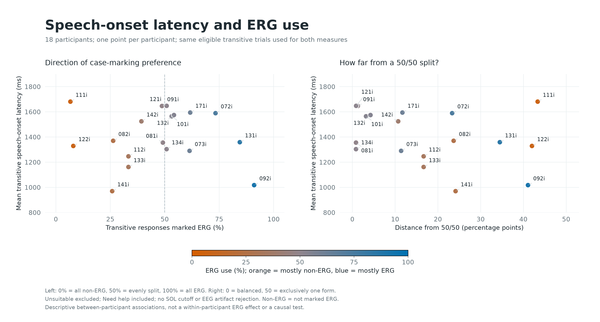

# Participant Speed and ERG Use

Frozen snapshot: 2026-10-20T22:11:42.094901+00:00

Each participant is one observation. Both ERG percentage and SOL use the same eligible transitive trials. SOL is acoustic onset minus EEG S200, not a PsychoPy keyboard reaction time. Unsuitable trials are excluded; Need help is included; no SOL cutoff or EEG artifact rejection.

ERG use = 100 * ERG / (ERG + not-marked-ERG). Distance from balance = abs(ERG percentage - 50), in percentage points. No arbitrary categorical cutoff is imposed. An absent ERG decision is counted as not marked ERG, as in the viewer, not independently verified absence.

| Participant | ERG | Non-ERG | ERG (%) | Distance from 50/50 (pp) | Mean transitive SOL (ms) | Median (ms) |
|---|---:|---:|---:|---:|---:|---:|
| 072i | 44 | 16 | 73.3 | 23.3 | 1589 | 1512 |
| 073i | 35 | 22 | 61.4 | 11.4 | 1290 | 1188 |
| 081i | 29 | 30 | 49.2 | 0.8 | 1355 | 1323 |
| 082i | 15 | 42 | 26.3 | 23.7 | 1370 | 1318 |
| 091i | 19 | 20 | 48.7 | 1.3 | 1646 | 1533 |
| 092i | 51 | 5 | 91.1 | 41.1 | 1017 | 982 |
| 101i | 25 | 22 | 53.2 | 3.2 | 1565 | 1522 |
| 111i | 3 | 42 | 6.7 | 43.3 | 1681 | 1549 |
| 112i | 18 | 36 | 33.3 | 16.7 | 1246 | 1111 |
| 121i | 29 | 28 | 50.9 | 0.9 | 1648 | 1516 |
| 122i | 4 | 46 | 8.0 | 42.0 | 1329 | 1265 |
| 131i | 49 | 9 | 84.5 | 34.5 | 1359 | 1241 |
| 132i | 32 | 27 | 54.2 | 4.2 | 1574 | 1509 |
| 133i | 20 | 40 | 33.3 | 16.7 | 1162 | 993 |
| 134i | 30 | 29 | 50.8 | 0.8 | 1303 | 1284 |
| 141i | 15 | 43 | 25.9 | 24.1 | 970 | 917 |
| 142i | 22 | 34 | 39.3 | 10.7 | 1524 | 1440 |
| 171i | 29 | 18 | 61.7 | 11.7 | 1594 | 1413 |

## Descriptive Correlations

Pearson r gives each participant equal weight. These exploratory correlations do not adjust for pictures, noun choice, participant characteristics or trial order; no inferential p-values are reported. They cannot establish that using ERG makes an individual faster/slower. The leave-one-out range shows sensitivity to omitting one participant, not a confidence interval.

| Predictor | Latency statistic | Pearson r | Leave-one-out range |
|---|---|---:|---|
| erg_percent | transitive_mean_sol_ms | -0.040 | -0.185 to 0.215 |
| erg_percent | transitive_median_sol_ms | -0.022 | -0.155 to 0.206 |
| distance_from_50_pp | transitive_mean_sol_ms | -0.319 | -0.539 to -0.174 |
| distance_from_50_pp | transitive_median_sol_ms | -0.341 | -0.539 to -0.218 |

